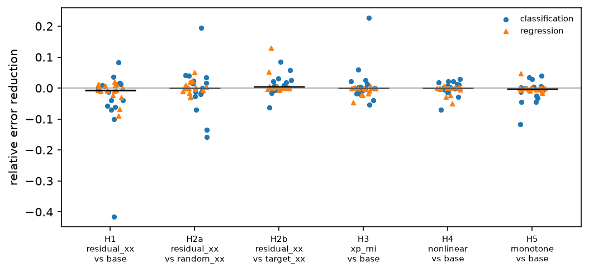
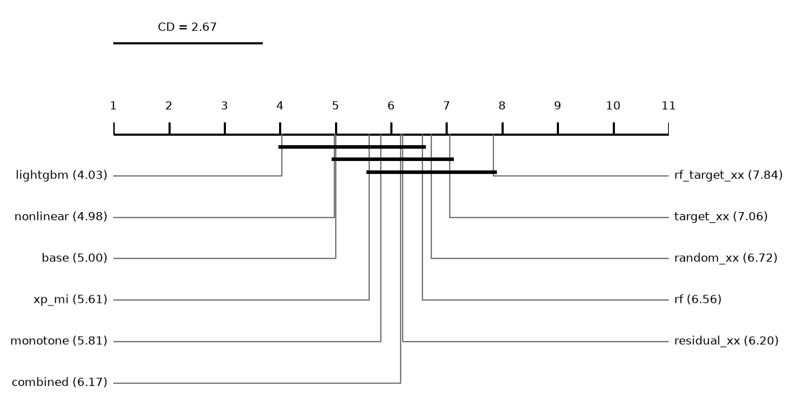
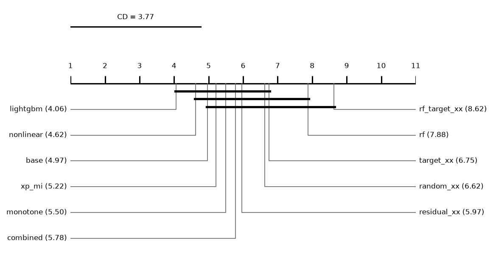
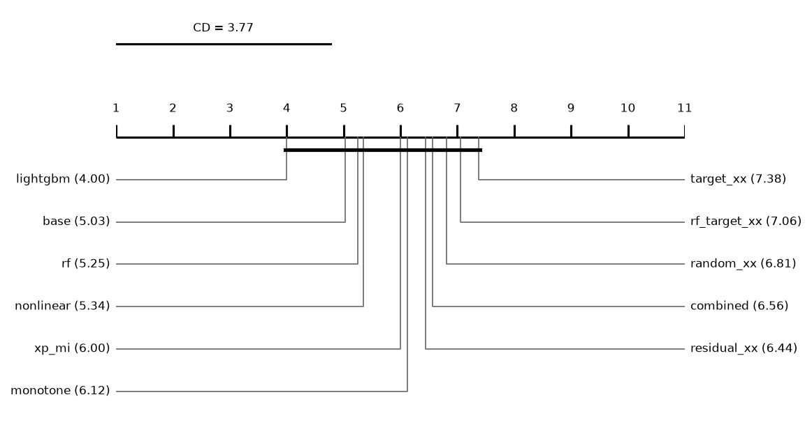

# Report: main

5280 runs on 32 datasets. Error = 1 - balanced accuracy (classification) or RMSE (regression); relative reduction = (e_ref - e) / max(e_ref, e) of errors averaged over a dataset's runs; positive favours the method.

**Bottom line: no hypothesis is supported** (Holm over the six comparisons, α = 0.05).

## Hypotheses (plan §5)
Two-sided Wilcoxon signed-rank over datasets, Holm over the six comparisons; supported iff adjusted p < 0.05 and median reduction > 0. **H2 supported: no** (needs H2a and H2b). *zeros*: datasets where both methods have the same mean error, e.g. when a variant that adds columns from layer 2 and base stop at layer 1 in every run; the test drops them. *hl_estimate*, *ci95_low/high*: Hodges-Lehmann estimate of the reduction and its exact 95% interval (descriptive, added after the main run).

| comparison | method | reference | datasets | median_reduction | wins | losses | zeros | p | hl_estimate | ci95_low | ci95_high | p_holm | supported |
|---|---|---|---|---|---|---|---|---|---|---|---|---|---|
| H1 | residual_xx | base | 32 | -0.0066 | 14 | 18 | 0 | 0.0945 | -0.0113 | -0.0312 | 0.0012 | 0.4727 | no |
| H2a | residual_xx | random_xx | 32 | 0.000228 | 16 | 16 | 0 | 0.8177 | 0.0013 | -0.0099 | 0.0116 | 1 | no |
| H2b | residual_xx | target_xx | 32 | 0.0029 | 20 | 9 | 3 | 0.0201 | 0.0043 | 0.000587 | 0.0137 | 0.1206 | no |
| H3 | xp_mi | base | 32 | -0.000643 | 9 | 17 | 6 | 0.2692 | -0.002 | -0.0093 | 0.0012 | 0.8077 | no |
| H4 | nonlinear | base | 32 | 0 | 14 | 12 | 6 | 0.8889 | 0 | -0.0072 | 0.0036 | 1 | no |
| H5 | monotone | base | 32 | -0.002 | 8 | 18 | 6 | 0.1014 | -0.0031 | -0.008 | 0 | 0.4727 | no |

## Hypotheses by task (exploratory)
Added after the main run at the instructor's suggestion: the six comparisons within each task, Holm over these 12. They decide no hypothesis (plan §5).

| task | comparison | method | reference | datasets | median_reduction | wins | losses | zeros | p | p_holm |
|---|---|---|---|---|---|---|---|---|---|---|
| classification | H1 | residual_xx | base | 16 | -0.0087 | 7 | 9 | 0 | 0.2114 | 1 |
| classification | H2a | residual_xx | random_xx | 16 | 0.0066 | 8 | 8 | 0 | 0.8603 | 1 |
| classification | H2b | residual_xx | target_xx | 16 | 0.0067 | 11 | 5 | 0 | 0.0934 | 0.9344 |
| classification | H3 | xp_mi | base | 16 | -0.000197 | 7 | 8 | 1 | 0.9096 | 1 |
| classification | H4 | nonlinear | base | 16 | 0.0034 | 10 | 6 | 0 | 0.5282 | 1 |
| classification | H5 | monotone | base | 16 | -0.0033 | 7 | 9 | 0 | 0.3484 | 1 |
| regression | H1 | residual_xx | base | 16 | -0.0066 | 7 | 9 | 0 | 0.2979 | 1 |
| regression | H2a | residual_xx | random_xx | 16 | 0.000118 | 8 | 8 | 0 | 0.9799 | 1 |
| regression | H2b | residual_xx | target_xx | 16 | 0.000397 | 9 | 4 | 3 | 0.1159 | 1 |
| regression | H3 | xp_mi | base | 16 | -0.0011 | 2 | 9 | 5 | 0.0329 | 0.3943 |
| regression | H4 | nonlinear | base | 16 | 0 | 4 | 6 | 6 | 0.2845 | 1 |
| regression | H5 | monotone | base | 16 | -0.0012 | 1 | 9 | 6 | 0.0745 | 0.8191 |

## The six comparisons on other metrics: classification (descriptive)
Error = 1 - metric where higher is better; two-sided Wilcoxon p without correction. Accuracy, ROC AUC, average precision and R² are computed from the saved float32 test predictions.

| metric | comparison | method | reference | datasets | median_reduction | wins | losses | zeros | p |
|---|---|---|---|---|---|---|---|---|---|
| accuracy | H1 | residual_xx | base | 16 | -0.0036 | 8 | 8 | 0 | 0.782 |
| accuracy | H2a | residual_xx | random_xx | 16 | -0.0013 | 7 | 8 | 1 | 0.6496 |
| accuracy | H2b | residual_xx | target_xx | 16 | 0.0031 | 11 | 5 | 0 | 0.1439 |
| accuracy | H3 | xp_mi | base | 16 | 0.000568 | 9 | 6 | 1 | 0.4265 |
| accuracy | H4 | nonlinear | base | 16 | 0.0018 | 10 | 6 | 0 | 0.5619 |
| accuracy | H5 | monotone | base | 16 | -0.0012 | 7 | 9 | 0 | 0.3225 |
| roc_auc | H1 | residual_xx | base | 16 | -0.0143 | 4 | 12 | 0 | 0.025 |
| roc_auc | H2a | residual_xx | random_xx | 16 | -0.0112 | 5 | 11 | 0 | 0.1754 |
| roc_auc | H2b | residual_xx | target_xx | 16 | 0.0011 | 8 | 8 | 0 | 0.6685 |
| roc_auc | H3 | xp_mi | base | 16 | 0.0042 | 9 | 7 | 0 | 0.9799 |
| roc_auc | H4 | nonlinear | base | 16 | 0.0018 | 9 | 7 | 0 | 0.5619 |
| roc_auc | H5 | monotone | base | 16 | -0.0221 | 2 | 14 | 0 | 0.0076 |
| average_precision | H1 | residual_xx | base | 16 | -0.0076 | 6 | 10 | 0 | 0.3484 |
| average_precision | H2a | residual_xx | random_xx | 16 | -0.0139 | 5 | 11 | 0 | 0.2522 |
| average_precision | H2b | residual_xx | target_xx | 16 | 0.0047 | 8 | 8 | 0 | 0.6322 |
| average_precision | H3 | xp_mi | base | 16 | 0.000266 | 8 | 8 | 0 | 0.5619 |
| average_precision | H4 | nonlinear | base | 16 | 0.0053 | 10 | 6 | 0 | 0.1591 |
| average_precision | H5 | monotone | base | 16 | -0.0091 | 2 | 14 | 0 | 0.0182 |
| log_loss | H1 | residual_xx | base | 16 | -0.013 | 5 | 11 | 0 | 0.2312 |
| log_loss | H2a | residual_xx | random_xx | 16 | -0.0103 | 6 | 10 | 0 | 0.2522 |
| log_loss | H2b | residual_xx | target_xx | 16 | 0.0066 | 11 | 5 | 0 | 0.0934 |
| log_loss | H3 | xp_mi | base | 16 | -0.0089 | 3 | 13 | 0 | 0.0386 |
| log_loss | H4 | nonlinear | base | 16 | 0.000896 | 9 | 7 | 0 | 0.7057 |
| log_loss | H5 | monotone | base | 16 | -0.0158 | 1 | 15 | 0 | 0.00058 |
| macro_f1 | H1 | residual_xx | base | 16 | 0.0026 | 9 | 7 | 0 | 0.5966 |
| macro_f1 | H2a | residual_xx | random_xx | 16 | 0.0058 | 8 | 8 | 0 | 0.8999 |
| macro_f1 | H2b | residual_xx | target_xx | 16 | 0.0051 | 10 | 6 | 0 | 0.1167 |
| macro_f1 | H3 | xp_mi | base | 16 | 0.0035 | 9 | 7 | 0 | 0.2979 |
| macro_f1 | H4 | nonlinear | base | 16 | 0.0034 | 10 | 6 | 0 | 0.5282 |
| macro_f1 | H5 | monotone | base | 16 | -0.0013 | 8 | 8 | 0 | 0.4637 |

## The six comparisons on other metrics: regression (descriptive)
Error = 1 - metric where higher is better; two-sided Wilcoxon p without correction. Accuracy, ROC AUC, average precision and R² are computed from the saved float32 test predictions.

| metric | comparison | method | reference | datasets | median_reduction | wins | losses | zeros | p |
|---|---|---|---|---|---|---|---|---|---|
| r2 | H1 | residual_xx | base | 16 | -0.0134 | 6 | 10 | 0 | 0.1167 |
| r2 | H2a | residual_xx | random_xx | 16 | -0.003 | 7 | 9 | 0 | 0.7057 |
| r2 | H2b | residual_xx | target_xx | 16 | 0.000479 | 8 | 5 | 3 | 0.1961 |
| r2 | H3 | xp_mi | base | 16 | -0.0051 | 2 | 9 | 5 | 0.0208 |
| r2 | H4 | nonlinear | base | 16 | 0 | 5 | 5 | 6 | 0.7989 |
| r2 | H5 | monotone | base | 16 | -0.0019 | 1 | 9 | 6 | 0.0745 |
| mae | H1 | residual_xx | base | 16 | -0.0066 | 6 | 10 | 0 | 0.1928 |
| mae | H2a | residual_xx | random_xx | 16 | -0.000866 | 7 | 9 | 0 | 0.782 |
| mae | H2b | residual_xx | target_xx | 16 | 9.66e-05 | 8 | 5 | 3 | 0.4216 |
| mae | H3 | xp_mi | base | 16 | -0.0024 | 3 | 8 | 5 | 0.0329 |
| mae | H4 | nonlinear | base | 16 | 0 | 5 | 5 | 6 | 0.2845 |
| mae | H5 | monotone | base | 16 | -0.0027 | 1 | 9 | 6 | 0.0745 |

## The six comparisons at a fixed depth (descriptive)
Every cascade cut at the same layer instead of its chosen one; only depths that every cascade run trained, so every run counts. Two-sided Wilcoxon p without correction.

| depth | comparison | method | reference | datasets | median_reduction | wins | losses | zeros | p |
|---|---|---|---|---|---|---|---|---|---|
| 1 | H1 | residual_xx | base | 32 | -0.0078 | 13 | 19 | 0 | 0.2951 |
| 1 | H2a | residual_xx | random_xx | 32 | 0.0085 | 20 | 12 | 0 | 0.0413 |
| 1 | H2b | residual_xx | target_xx | 32 | 0 | 0 | 0 | 32 | 1 |
| 1 | H3 | xp_mi | base | 32 | 0 | 0 | 0 | 32 | 1 |
| 1 | H4 | nonlinear | base | 32 | 0 | 0 | 0 | 32 | 1 |
| 1 | H5 | monotone | base | 32 | 0 | 0 | 0 | 32 | 1 |
| 2 | H1 | residual_xx | base | 32 | -0.0076 | 8 | 24 | 0 | 0.0118 |
| 2 | H2a | residual_xx | random_xx | 32 | 0.0027 | 18 | 14 | 0 | 0.5 |
| 2 | H2b | residual_xx | target_xx | 32 | 0.0073 | 24 | 8 | 0 | 0.0039 |
| 2 | H3 | xp_mi | base | 32 | -0.0021 | 12 | 20 | 0 | 0.4105 |
| 2 | H4 | nonlinear | base | 32 | 0.000429 | 16 | 16 | 0 | 0.9632 |
| 2 | H5 | monotone | base | 32 | -0.0033 | 8 | 23 | 1 | 0.147 |
| 3 | H1 | residual_xx | base | 32 | -0.0025 | 14 | 18 | 0 | 0.3694 |
| 3 | H2a | residual_xx | random_xx | 32 | -0.000559 | 15 | 16 | 1 | 0.4928 |
| 3 | H2b | residual_xx | target_xx | 32 | 0.0045 | 21 | 11 | 0 | 0.0394 |
| 3 | H3 | xp_mi | base | 32 | -0.0088 | 11 | 21 | 0 | 0.0184 |
| 3 | H4 | nonlinear | base | 32 | -0.0027 | 13 | 19 | 0 | 0.0376 |
| 3 | H5 | monotone | base | 32 | -0.0109 | 8 | 24 | 0 | 0.0036 |

## Depth rule of the base cascade (descriptive)
*picked*: share of base runs whose chosen layer is this depth. *median_test_vs_oof*: median over runs of (OOF error - test error) / max of the two, with the OOF error from the depth score (1 - balanced accuracy, or √MSE); positive = the test error is lower than the OOF error the rule sees. *median_reduction* to *p*: base cut at this depth vs base at its chosen layer, over datasets; positive = the fixed depth has the lower error.

| depth | picked | picked_classification | picked_regression | median_test_vs_oof | median_reduction | wins | losses | zeros | p |
|---|---|---|---|---|---|---|---|---|---|
| 1 | 0.4313 | 0.2917 | 0.5708 | 0.0236 | -0.0163 | 6 | 20 | 6 | 0.000479 |
| 2 | 0.4667 | 0.5375 | 0.3958 | 0.0688 | 0.0047 | 19 | 9 | 4 | 0.0131 |
| 3 | 0.0708 | 0.1333 | 0.0083 | 0.0905 | 0.006 | 18 | 14 | 0 | 0.2951 |

## Other methods vs the base cascade (descriptive)
Two-sided Wilcoxon p without Holm's correction.

| comparison | method | reference | datasets | median_reduction | wins | losses | zeros | p |
|---|---|---|---|---|---|---|---|---|
| random_xx | random_xx | base | 32 | -0.0093 | 9 | 23 | 0 | 0.000837 |
| target_xx | target_xx | base | 32 | -0.0082 | 11 | 21 | 0 | 0.0029 |
| combined | combined | base | 32 | -0.0058 | 13 | 19 | 0 | 0.057 |
| rf | rf | base | 32 | -0.0255 | 11 | 21 | 0 | 0.0073 |
| rf_target_xx | rf_target_xx | base | 32 | -0.0219 | 9 | 23 | 0 | 0.0013 |
| lightgbm | lightgbm | base | 32 | 0.0108 | 21 | 11 | 0 | 0.0595 |

## Mean ranks
Friedman over 11 methods and 32 datasets: chi2 = 33.87, p = 0.000195; Nemenyi critical difference = 2.67 (descriptive).

| method | mean rank |
|---|---|
| lightgbm | 4.0312 |
| nonlinear | 4.9844 |
| base | 5 |
| xp_mi | 5.6094 |
| monotone | 5.8125 |
| combined | 6.1719 |
| residual_xx | 6.2031 |
| rf | 6.5625 |
| random_xx | 6.7188 |
| target_xx | 7.0625 |
| rf_target_xx | 7.8438 |

## Other methods vs the base cascade: classification (descriptive)
Two-sided Wilcoxon p without Holm's correction.

| comparison | method | reference | datasets | median_reduction | wins | losses | zeros | p |
|---|---|---|---|---|---|---|---|---|
| random_xx | random_xx | base | 16 | -0.0207 | 4 | 12 | 0 | 0.029 |
| target_xx | target_xx | base | 16 | -0.0093 | 5 | 11 | 0 | 0.029 |
| combined | combined | base | 16 | -0.0074 | 7 | 9 | 0 | 0.2114 |
| rf | rf | base | 16 | -0.0318 | 3 | 13 | 0 | 0.0052 |
| rf_target_xx | rf_target_xx | base | 16 | -0.0661 | 3 | 13 | 0 | 0.0027 |
| lightgbm | lightgbm | base | 16 | 0.0108 | 10 | 6 | 0 | 0.2979 |

## Mean ranks: classification
Friedman over 11 methods and 16 datasets: chi2 = 27.62, p = 0.0021; Nemenyi critical difference = 3.77 (descriptive).

| method | mean rank |
|---|---|
| lightgbm | 4.0625 |
| nonlinear | 4.625 |
| base | 4.9688 |
| xp_mi | 5.2188 |
| monotone | 5.5 |
| combined | 5.7812 |
| residual_xx | 5.9688 |
| random_xx | 6.625 |
| target_xx | 6.75 |
| rf | 7.875 |
| rf_target_xx | 8.625 |

## Other methods vs the base cascade: regression (descriptive)
Two-sided Wilcoxon p without Holm's correction.

| comparison | method | reference | datasets | median_reduction | wins | losses | zeros | p |
|---|---|---|---|---|---|---|---|---|
| random_xx | random_xx | base | 16 | -0.0075 | 5 | 11 | 0 | 0.011 |
| target_xx | target_xx | base | 16 | -0.0053 | 6 | 10 | 0 | 0.0507 |
| combined | combined | base | 16 | -0.0058 | 6 | 10 | 0 | 0.1167 |
| rf | rf | base | 16 | -0.001 | 8 | 8 | 0 | 0.3755 |
| rf_target_xx | rf_target_xx | base | 16 | -0.0077 | 6 | 10 | 0 | 0.1591 |
| lightgbm | lightgbm | base | 16 | 0.0116 | 11 | 5 | 0 | 0.1297 |

## Mean ranks: regression
Friedman over 11 methods and 16 datasets: chi2 = 15.03, p = 0.1311; Nemenyi critical difference = 3.77 (descriptive).

| method | mean rank |
|---|---|
| lightgbm | 4 |
| base | 5.0312 |
| rf | 5.25 |
| nonlinear | 5.3438 |
| xp_mi | 6 |
| monotone | 6.125 |
| residual_xx | 6.4375 |
| combined | 6.5625 |
| random_xx | 6.8125 |
| rf_target_xx | 7.0625 |
| target_xx | 7.375 |

## Common depth (descriptive)
Median relative reduction vs base at each depth reached by every cascade variant in a run; *runs* counts those runs, so deep rows rest on few.

| depth | random_xx | target_xx | residual_xx | xp_mi | nonlinear | monotone | combined | datasets | runs |
|---|---|---|---|---|---|---|---|---|---|
| 1 | -0.0104 | -0.0078 | -0.0078 | 0 | 0 | 0 | -0.0078 | 32 | 480 |
| 2 | -0.0107 | -0.0195 | -0.0076 | -0.0021 | 0.000429 | -0.0033 | -0.0108 | 32 | 480 |
| 3 | -0.0029 | -0.0027 | -0.0025 | -0.0088 | -0.0027 | -0.0109 | -0.0024 | 32 | 480 |
| 4 | -0.003 | -0.000716 | 0.0032 | -0.0062 | 0 | -0.0138 | -0.007 | 21 | 166 |
| 5 | 0.0022 | 0.0497 | 0.0269 | 0.0355 | -0.0041 | 0.0324 | 0.0315 | 2 | 3 |
| 6 | -0.0298 | 0.0152 | 0.0278 | -0.0442 | 0.0217 | 0.0088 | -0.0296 | 1 | 1 |

## XP products vs the predictions

Median over runs of the median max |corr| between chosen XP products and P: 0.316 (IQR 0.213-0.407).

## Per dataset: balanced_accuracy mean ± sd (classification)
| dataset | base | random_xx | target_xx | residual_xx | xp_mi | nonlinear | monotone | combined | rf | rf_target_xx | lightgbm |
|---|---|---|---|---|---|---|---|---|---|---|---|
| adult | 0.7696 ± 0.009 | 0.7671 ± 0.0068 | 0.7697 ± 0.0077 | 0.771 ± 0.0073 | 0.7653 ± 0.0095 | 0.7663 ± 0.0067 | 0.7687 ± 0.008 | 0.769 ± 0.0076 | 0.7688 ± 0.0068 | 0.7663 ± 0.0059 | 0.7892 ± 0.0074 |
| bank_marketing | 0.6032 ± 0.0083 | 0.6027 ± 0.0083 | 0.6063 ± 0.0093 | 0.6082 ± 0.0098 | 0.6019 ± 0.0066 | 0.6014 ± 0.0078 | 0.6007 ± 0.0072 | 0.6064 ± 0.0098 | 0.6067 ± 0.0071 | 0.6106 ± 0.0082 | 0.6081 ± 0.0068 |
| cardiotocography | 0.8433 ± 0.032 | 0.8432 ± 0.027 | 0.8277 ± 0.034 | 0.8315 ± 0.034 | 0.8344 ± 0.025 | 0.8454 ± 0.029 | 0.8412 ± 0.027 | 0.8312 ± 0.036 | 0.8237 ± 0.031 | 0.8091 ± 0.039 | 0.8383 ± 0.026 |
| climate_crashes | 0.7624 ± 0.093 | 0.7296 ± 0.09 | 0.7615 ± 0.077 | 0.7819 ± 0.075 | 0.7593 ± 0.086 | 0.7553 ± 0.092 | 0.7512 ± 0.086 | 0.7846 ± 0.075 | 0.5659 ± 0.048 | 0.6285 ± 0.078 | 0.731 ± 0.084 |
| credit_default | 0.6601 ± 0.0084 | 0.6608 ± 0.011 | 0.6599 ± 0.01 | 0.6606 ± 0.01 | 0.6599 ± 0.0099 | 0.6595 ± 0.0079 | 0.6591 ± 0.0079 | 0.6603 ± 0.0098 | 0.6587 ± 0.0068 | 0.6586 ± 0.0084 | 0.6592 ± 0.0094 |
| german_credit | 0.6621 ± 0.037 | 0.6568 ± 0.04 | 0.6658 ± 0.029 | 0.6651 ± 0.03 | 0.6621 ± 0.037 | 0.6636 ± 0.038 | 0.664 ± 0.038 | 0.6653 ± 0.029 | 0.652 ± 0.032 | 0.6705 ± 0.032 | 0.6638 ± 0.028 |
| heart_statlog | 0.8239 ± 0.046 | 0.8192 ± 0.049 | 0.8222 ± 0.048 | 0.8267 ± 0.046 | 0.8344 ± 0.037 | 0.8289 ± 0.046 | 0.83 ± 0.041 | 0.8258 ± 0.045 | 0.8128 ± 0.043 | 0.8086 ± 0.047 | 0.8231 ± 0.031 |
| page_blocks | 0.8583 ± 0.049 | 0.8497 ± 0.073 | 0.8511 ± 0.065 | 0.8525 ± 0.061 | 0.86 ± 0.056 | 0.8599 ± 0.053 | 0.8625 ± 0.054 | 0.8503 ± 0.063 | 0.8426 ± 0.057 | 0.8549 ± 0.05 | 0.8455 ± 0.049 |
| phishing | 0.9527 ± 0.0055 | 0.9501 ± 0.0068 | 0.9522 ± 0.0053 | 0.9521 ± 0.0052 | 0.9527 ± 0.0055 | 0.9528 ± 0.0055 | 0.9527 ± 0.0058 | 0.9521 ± 0.0052 | 0.9539 ± 0.0059 | 0.9533 ± 0.0055 | 0.9538 ± 0.0069 |
| qsar_biodeg | 0.8404 ± 0.035 | 0.8417 ± 0.035 | 0.8407 ± 0.036 | 0.8395 ± 0.035 | 0.8438 ± 0.038 | 0.844 ± 0.036 | 0.8411 ± 0.035 | 0.8414 ± 0.034 | 0.8403 ± 0.036 | 0.837 ± 0.031 | 0.8451 ± 0.038 |
| sonar | 0.8449 ± 0.05 | 0.8548 ± 0.06 | 0.8245 ± 0.044 | 0.8277 ± 0.04 | 0.8422 ± 0.051 | 0.8478 ± 0.051 | 0.8377 ± 0.045 | 0.8327 ± 0.05 | 0.8393 ± 0.052 | 0.8167 ± 0.059 | 0.857 ± 0.05 |
| spambase | 0.9471 ± 0.0078 | 0.9472 ± 0.009 | 0.9486 ± 0.0084 | 0.949 ± 0.0075 | 0.945 ± 0.0094 | 0.9472 ± 0.0077 | 0.9457 ± 0.0073 | 0.949 ± 0.0081 | 0.9457 ± 0.0089 | 0.9432 ± 0.01 | 0.9478 ± 0.011 |
| spectf | 0.6409 ± 0.071 | 0.6262 ± 0.057 | 0.5953 ± 0.065 | 0.6188 ± 0.073 | 0.65 ± 0.063 | 0.6356 ± 0.067 | 0.6551 ± 0.08 | 0.6224 ± 0.079 | 0.6014 ± 0.05 | 0.5737 ± 0.052 | 0.6337 ± 0.055 |
| steel_plates | 0.7823 ± 0.039 | 0.776 ± 0.035 | 0.7663 ± 0.027 | 0.7734 ± 0.032 | 0.781 ± 0.035 | 0.7839 ± 0.037 | 0.7825 ± 0.039 | 0.7763 ± 0.033 | 0.7855 ± 0.031 | 0.7661 ± 0.029 | 0.802 ± 0.02 |
| tictactoe | 0.9864 ± 0.011 | 0.9798 ± 0.012 | 0.9781 ± 0.018 | 0.9767 ± 0.019 | 0.9895 ± 0.0098 | 0.9853 ± 0.013 | 0.9846 ± 0.011 | 0.9774 ± 0.019 | 0.9834 ± 0.0091 | 0.9634 ± 0.017 | 0.9955 ± 0.0085 |
| vehicle | 0.7694 ± 0.035 | 0.761 ± 0.026 | 0.7586 ± 0.019 | 0.7545 ± 0.026 | 0.7702 ± 0.036 | 0.7745 ± 0.03 | 0.7615 ± 0.033 | 0.7555 ± 0.021 | 0.7464 ± 0.025 | 0.7537 ± 0.028 | 0.7715 ± 0.031 |

## Per dataset: log_loss mean ± sd (classification)
| dataset | base | random_xx | target_xx | residual_xx | xp_mi | nonlinear | monotone | combined | rf | rf_target_xx | lightgbm |
|---|---|---|---|---|---|---|---|---|---|---|---|
| adult | 0.3187 ± 0.012 | 0.3148 ± 0.0093 | 0.3081 ± 0.0084 | 0.3128 ± 0.011 | 0.3222 ± 0.014 | 0.3232 ± 0.011 | 0.3269 ± 0.013 | 0.3139 ± 0.011 | 0.3579 ± 0.013 | 0.3552 ± 0.015 | 0.2843 ± 0.009 |
| bank_marketing | 0.2981 ± 0.0077 | 0.2966 ± 0.0073 | 0.3029 ± 0.0071 | 0.3011 ± 0.011 | 0.2985 ± 0.0084 | 0.2976 ± 0.0057 | 0.2995 ± 0.007 | 0.3003 ± 0.011 | 0.3153 ± 0.016 | 0.3358 ± 0.014 | 0.2877 ± 0.0044 |
| cardiotocography | 0.221 ± 0.041 | 0.2249 ± 0.043 | 0.2329 ± 0.037 | 0.2287 ± 0.038 | 0.2225 ± 0.038 | 0.2228 ± 0.042 | 0.2213 ± 0.042 | 0.228 ± 0.039 | 0.2268 ± 0.032 | 0.2343 ± 0.034 | 0.2237 ± 0.054 |
| climate_crashes | 0.1442 ± 0.02 | 0.1519 ± 0.017 | 0.1343 ± 0.021 | 0.1342 ± 0.021 | 0.1742 ± 0.11 | 0.1567 ± 0.069 | 0.1764 ± 0.1 | 0.1324 ± 0.02 | 0.1852 ± 0.017 | 0.1709 ± 0.021 | 0.1402 ± 0.035 |
| credit_default | 0.434 ± 0.0063 | 0.4342 ± 0.0062 | 0.4355 ± 0.0066 | 0.4368 ± 0.0065 | 0.4362 ± 0.0068 | 0.4338 ± 0.0054 | 0.4347 ± 0.0055 | 0.4377 ± 0.0059 | 0.4422 ± 0.0051 | 0.4512 ± 0.009 | 0.4284 ± 0.0056 |
| german_credit | 0.5007 ± 0.027 | 0.5 ± 0.028 | 0.505 ± 0.038 | 0.5014 ± 0.033 | 0.4997 ± 0.025 | 0.499 ± 0.026 | 0.5013 ± 0.029 | 0.501 ± 0.033 | 0.4972 ± 0.026 | 0.5138 ± 0.058 | 0.5009 ± 0.032 |
| heart_statlog | 0.394 ± 0.039 | 0.3984 ± 0.037 | 0.3952 ± 0.055 | 0.3854 ± 0.043 | 0.4016 ± 0.045 | 0.3925 ± 0.034 | 0.3993 ± 0.041 | 0.3925 ± 0.059 | 0.3984 ± 0.034 | 0.4008 ± 0.055 | 0.3932 ± 0.043 |
| page_blocks | 0.0972 ± 0.022 | 0.09345 ± 0.028 | 0.1029 ± 0.028 | 0.1009 ± 0.025 | 0.1013 ± 0.021 | 0.1005 ± 0.024 | 0.1087 ± 0.023 | 0.09797 ± 0.025 | 0.1212 ± 0.028 | 0.1176 ± 0.032 | 0.08178 ± 0.011 |
| phishing | 0.1305 ± 0.01 | 0.128 ± 0.014 | 0.1316 ± 0.011 | 0.1326 ± 0.0099 | 0.132 ± 0.0093 | 0.1302 ± 0.013 | 0.1292 ± 0.014 | 0.1326 ± 0.0099 | 0.1204 ± 0.01 | 0.1233 ± 0.011 | 0.1035 ± 0.013 |
| qsar_biodeg | 0.3196 ± 0.039 | 0.3182 ± 0.037 | 0.3241 ± 0.055 | 0.3145 ± 0.038 | 0.3344 ± 0.084 | 0.3236 ± 0.056 | 0.337 ± 0.062 | 0.3222 ± 0.052 | 0.3318 ± 0.076 | 0.3201 ± 0.044 | 0.3138 ± 0.046 |
| sonar | 0.365 ± 0.074 | 0.371 ± 0.07 | 0.424 ± 0.045 | 0.4096 ± 0.046 | 0.3807 ± 0.074 | 0.3645 ± 0.075 | 0.3788 ± 0.072 | 0.4211 ± 0.047 | 0.4071 ± 0.031 | 0.4229 ± 0.037 | 0.3744 ± 0.1 |
| spambase | 0.1591 ± 0.029 | 0.1552 ± 0.025 | 0.1481 ± 0.024 | 0.1485 ± 0.02 | 0.1798 ± 0.039 | 0.1578 ± 0.031 | 0.1696 ± 0.036 | 0.1507 ± 0.023 | 0.165 ± 0.019 | 0.1735 ± 0.035 | 0.1343 ± 0.025 |
| spectf | 0.3739 ± 0.034 | 0.3888 ± 0.029 | 0.3997 ± 0.028 | 0.3886 ± 0.027 | 0.3758 ± 0.035 | 0.3802 ± 0.033 | 0.3809 ± 0.036 | 0.3922 ± 0.036 | 0.3744 ± 0.026 | 0.3946 ± 0.024 | 0.4029 ± 0.05 |
| steel_plates | 0.5693 ± 0.049 | 0.5715 ± 0.047 | 0.6157 ± 0.034 | 0.5869 ± 0.036 | 0.5699 ± 0.051 | 0.5712 ± 0.048 | 0.5814 ± 0.051 | 0.5826 ± 0.036 | 0.6096 ± 0.052 | 0.6385 ± 0.057 | 0.5125 ± 0.033 |
| tictactoe | 0.03653 ± 0.013 | 0.06357 ± 0.018 | 0.1155 ± 0.081 | 0.1153 ± 0.081 | 0.03096 ± 0.01 | 0.03568 ± 0.014 | 0.0367 ± 0.015 | 0.1159 ± 0.081 | 0.2146 ± 0.0095 | 0.2063 ± 0.019 | 0.0168 ± 0.011 |
| vehicle | 0.442 ± 0.063 | 0.4286 ± 0.021 | 0.4482 ± 0.043 | 0.4614 ± 0.056 | 0.425 ± 0.046 | 0.4262 ± 0.047 | 0.4453 ± 0.053 | 0.4563 ± 0.051 | 0.5089 ± 0.022 | 0.5018 ± 0.02 | 0.4715 ± 0.045 |

## Per dataset: macro_f1 mean ± sd (classification)
| dataset | base | random_xx | target_xx | residual_xx | xp_mi | nonlinear | monotone | combined | rf | rf_target_xx | lightgbm |
|---|---|---|---|---|---|---|---|---|---|---|---|
| adult | 0.7886 ± 0.0095 | 0.7878 ± 0.0068 | 0.7906 ± 0.0081 | 0.7904 ± 0.0071 | 0.784 ± 0.0083 | 0.7849 ± 0.0071 | 0.7858 ± 0.0075 | 0.7895 ± 0.0077 | 0.7816 ± 0.007 | 0.7825 ± 0.006 | 0.8077 ± 0.0074 |
| bank_marketing | 0.6362 ± 0.01 | 0.6356 ± 0.011 | 0.6387 ± 0.011 | 0.6411 ± 0.012 | 0.6347 ± 0.0086 | 0.6344 ± 0.0098 | 0.6332 ± 0.0095 | 0.6395 ± 0.012 | 0.6398 ± 0.0086 | 0.6427 ± 0.0094 | 0.6417 ± 0.0086 |
| cardiotocography | 0.8446 ± 0.028 | 0.8481 ± 0.028 | 0.8313 ± 0.026 | 0.8366 ± 0.029 | 0.8416 ± 0.025 | 0.8493 ± 0.029 | 0.8464 ± 0.03 | 0.8333 ± 0.03 | 0.8407 ± 0.031 | 0.8287 ± 0.033 | 0.8518 ± 0.029 |
| climate_crashes | 0.802 ± 0.089 | 0.7826 ± 0.084 | 0.8084 ± 0.066 | 0.8248 ± 0.061 | 0.8049 ± 0.084 | 0.7973 ± 0.087 | 0.7929 ± 0.082 | 0.824 ± 0.066 | 0.5912 ± 0.077 | 0.6761 ± 0.1 | 0.7866 ± 0.079 |
| credit_default | 0.6842 ± 0.009 | 0.6849 ± 0.012 | 0.6839 ± 0.011 | 0.6848 ± 0.011 | 0.684 ± 0.011 | 0.6838 ± 0.0083 | 0.6833 ± 0.0083 | 0.6844 ± 0.01 | 0.6819 ± 0.0069 | 0.6811 ± 0.0088 | 0.6844 ± 0.01 |
| german_credit | 0.6761 ± 0.042 | 0.6693 ± 0.045 | 0.678 ± 0.032 | 0.6773 ± 0.033 | 0.676 ± 0.042 | 0.6774 ± 0.043 | 0.6777 ± 0.042 | 0.6778 ± 0.032 | 0.6651 ± 0.038 | 0.6836 ± 0.037 | 0.6756 ± 0.03 |
| heart_statlog | 0.8241 ± 0.049 | 0.8201 ± 0.048 | 0.8239 ± 0.049 | 0.8291 ± 0.047 | 0.835 ± 0.038 | 0.8296 ± 0.047 | 0.8306 ± 0.043 | 0.8273 ± 0.046 | 0.8134 ± 0.044 | 0.8099 ± 0.049 | 0.8245 ± 0.032 |
| page_blocks | 0.8575 ± 0.041 | 0.8567 ± 0.059 | 0.8616 ± 0.044 | 0.863 ± 0.043 | 0.8608 ± 0.042 | 0.8601 ± 0.038 | 0.8619 ± 0.044 | 0.8591 ± 0.043 | 0.8499 ± 0.047 | 0.8636 ± 0.035 | 0.8568 ± 0.038 |
| phishing | 0.953 ± 0.0056 | 0.95 ± 0.0068 | 0.9525 ± 0.0051 | 0.9523 ± 0.0049 | 0.9531 ± 0.0056 | 0.9531 ± 0.0056 | 0.9532 ± 0.0059 | 0.9523 ± 0.0049 | 0.9543 ± 0.0058 | 0.9532 ± 0.0053 | 0.954 ± 0.0067 |
| qsar_biodeg | 0.8464 ± 0.031 | 0.8506 ± 0.034 | 0.8492 ± 0.033 | 0.8478 ± 0.032 | 0.8503 ± 0.034 | 0.8499 ± 0.031 | 0.847 ± 0.031 | 0.8492 ± 0.031 | 0.8481 ± 0.034 | 0.8455 ± 0.029 | 0.8504 ± 0.035 |
| sonar | 0.8438 ± 0.051 | 0.8551 ± 0.059 | 0.8255 ± 0.044 | 0.8287 ± 0.039 | 0.8415 ± 0.051 | 0.8469 ± 0.052 | 0.8369 ± 0.046 | 0.8337 ± 0.049 | 0.84 ± 0.051 | 0.8171 ± 0.06 | 0.8561 ± 0.051 |
| spambase | 0.9482 ± 0.0082 | 0.9482 ± 0.0094 | 0.9501 ± 0.0084 | 0.9503 ± 0.0077 | 0.9461 ± 0.0097 | 0.9484 ± 0.0082 | 0.9471 ± 0.008 | 0.9504 ± 0.0082 | 0.9475 ± 0.0092 | 0.9442 ± 0.011 | 0.9482 ± 0.012 |
| spectf | 0.649 ± 0.084 | 0.6388 ± 0.065 | 0.5997 ± 0.083 | 0.6275 ± 0.089 | 0.6613 ± 0.064 | 0.6385 ± 0.075 | 0.6588 ± 0.092 | 0.6283 ± 0.092 | 0.6143 ± 0.063 | 0.577 ± 0.076 | 0.6422 ± 0.058 |
| steel_plates | 0.7976 ± 0.029 | 0.794 ± 0.028 | 0.7849 ± 0.02 | 0.792 ± 0.026 | 0.7989 ± 0.026 | 0.7988 ± 0.028 | 0.7977 ± 0.029 | 0.794 ± 0.025 | 0.8015 ± 0.025 | 0.7856 ± 0.022 | 0.8161 ± 0.014 |
| tictactoe | 0.9858 ± 0.011 | 0.9804 ± 0.012 | 0.9773 ± 0.016 | 0.9765 ± 0.017 | 0.9892 ± 0.0092 | 0.9847 ± 0.013 | 0.9839 ± 0.011 | 0.9773 ± 0.017 | 0.9864 ± 0.0075 | 0.9663 ± 0.015 | 0.9965 ± 0.0065 |
| vehicle | 0.7631 ± 0.038 | 0.7531 ± 0.027 | 0.7504 ± 0.02 | 0.7463 ± 0.027 | 0.7653 ± 0.038 | 0.768 ± 0.032 | 0.7548 ± 0.034 | 0.7473 ± 0.021 | 0.7377 ± 0.028 | 0.7461 ± 0.03 | 0.7665 ± 0.034 |

## Per dataset: accuracy mean ± sd (classification)
| dataset | base | random_xx | target_xx | residual_xx | xp_mi | nonlinear | monotone | combined | rf | rf_target_xx | lightgbm |
|---|---|---|---|---|---|---|---|---|---|---|---|
| adult | 0.8566 ± 0.0069 | 0.8571 ± 0.0048 | 0.859 ± 0.0057 | 0.8579 ± 0.0048 | 0.8536 ± 0.0053 | 0.8539 ± 0.0054 | 0.8536 ± 0.0057 | 0.8581 ± 0.0054 | 0.8481 ± 0.0054 | 0.8509 ± 0.0046 | 0.8685 ± 0.0051 |
| bank_marketing | 0.8939 ± 0.002 | 0.8939 ± 0.0023 | 0.8927 ± 0.0024 | 0.893 ± 0.0026 | 0.8938 ± 0.0027 | 0.8943 ± 0.0025 | 0.8936 ± 0.0026 | 0.8935 ± 0.003 | 0.8935 ± 0.002 | 0.8916 ± 0.0021 | 0.8939 ± 0.0023 |
| cardiotocography | 0.9124 ± 0.022 | 0.9128 ± 0.023 | 0.9031 ± 0.021 | 0.9069 ± 0.022 | 0.9111 ± 0.02 | 0.9152 ± 0.022 | 0.9128 ± 0.021 | 0.9048 ± 0.022 | 0.9125 ± 0.021 | 0.9047 ± 0.023 | 0.9153 ± 0.021 |
| climate_crashes | 0.9506 ± 0.017 | 0.9488 ± 0.017 | 0.9519 ± 0.014 | 0.9549 ± 0.012 | 0.9519 ± 0.016 | 0.95 ± 0.016 | 0.9488 ± 0.015 | 0.9537 ± 0.014 | 0.9259 ± 0.0099 | 0.9364 ± 0.015 | 0.95 ± 0.016 |
| credit_default | 0.8188 ± 0.0037 | 0.8189 ± 0.0048 | 0.8185 ± 0.0046 | 0.819 ± 0.0042 | 0.8186 ± 0.0045 | 0.8189 ± 0.0032 | 0.8186 ± 0.0029 | 0.8186 ± 0.0037 | 0.8163 ± 0.0025 | 0.8145 ± 0.0037 | 0.8209 ± 0.0036 |
| german_credit | 0.7633 ± 0.032 | 0.7573 ± 0.033 | 0.757 ± 0.029 | 0.7573 ± 0.029 | 0.7633 ± 0.03 | 0.762 ± 0.033 | 0.763 ± 0.031 | 0.7577 ± 0.029 | 0.7563 ± 0.029 | 0.76 ± 0.034 | 0.7547 ± 0.023 |
| heart_statlog | 0.8284 ± 0.048 | 0.8247 ± 0.046 | 0.8284 ± 0.048 | 0.8346 ± 0.043 | 0.8383 ± 0.037 | 0.8333 ± 0.046 | 0.8346 ± 0.042 | 0.8309 ± 0.046 | 0.8173 ± 0.044 | 0.8148 ± 0.047 | 0.8284 ± 0.032 |
| page_blocks | 0.975 ± 0.0037 | 0.9759 ± 0.0047 | 0.9755 ± 0.004 | 0.9758 ± 0.0038 | 0.9753 ± 0.0034 | 0.9751 ± 0.0037 | 0.9753 ± 0.0033 | 0.9752 ± 0.0038 | 0.9744 ± 0.0042 | 0.9749 ± 0.0041 | 0.9747 ± 0.0034 |
| phishing | 0.9537 ± 0.0056 | 0.9507 ± 0.0068 | 0.9531 ± 0.005 | 0.953 ± 0.0049 | 0.9537 ± 0.0056 | 0.9537 ± 0.0056 | 0.9538 ± 0.0058 | 0.953 ± 0.0049 | 0.9549 ± 0.0057 | 0.9538 ± 0.0052 | 0.9546 ± 0.0067 |
| qsar_biodeg | 0.8657 ± 0.026 | 0.8705 ± 0.029 | 0.8692 ± 0.027 | 0.8679 ± 0.027 | 0.8695 ± 0.028 | 0.8689 ± 0.026 | 0.8664 ± 0.025 | 0.8689 ± 0.026 | 0.8679 ± 0.029 | 0.866 ± 0.023 | 0.8689 ± 0.03 |
| sonar | 0.8463 ± 0.048 | 0.8575 ± 0.057 | 0.8285 ± 0.044 | 0.8317 ± 0.039 | 0.8447 ± 0.048 | 0.8494 ± 0.049 | 0.8398 ± 0.043 | 0.8364 ± 0.048 | 0.8431 ± 0.05 | 0.8205 ± 0.059 | 0.8576 ± 0.051 |
| spambase | 0.9507 ± 0.0079 | 0.9507 ± 0.009 | 0.9525 ± 0.008 | 0.9526 ± 0.0073 | 0.9486 ± 0.0094 | 0.9508 ± 0.0079 | 0.9496 ± 0.0078 | 0.9528 ± 0.0078 | 0.95 ± 0.0089 | 0.9468 ± 0.011 | 0.9506 ± 0.012 |
| spectf | 0.8076 ± 0.035 | 0.8127 ± 0.024 | 0.8064 ± 0.029 | 0.8152 ± 0.025 | 0.8077 ± 0.031 | 0.8027 ± 0.024 | 0.8088 ± 0.044 | 0.8102 ± 0.03 | 0.8089 ± 0.025 | 0.804 ± 0.029 | 0.7889 ± 0.038 |
| steel_plates | 0.7797 ± 0.026 | 0.7785 ± 0.025 | 0.7652 ± 0.022 | 0.7737 ± 0.024 | 0.7802 ± 0.022 | 0.7793 ± 0.026 | 0.7797 ± 0.026 | 0.7745 ± 0.025 | 0.7826 ± 0.02 | 0.767 ± 0.02 | 0.7948 ± 0.013 |
| tictactoe | 0.9871 ± 0.01 | 0.9823 ± 0.011 | 0.9795 ± 0.014 | 0.9788 ± 0.015 | 0.9902 ± 0.0084 | 0.9861 ± 0.012 | 0.9854 ± 0.01 | 0.9795 ± 0.015 | 0.9878 ± 0.0067 | 0.9697 ± 0.013 | 0.9969 ± 0.0059 |
| vehicle | 0.7667 ± 0.035 | 0.7573 ± 0.025 | 0.7557 ± 0.018 | 0.751 ± 0.026 | 0.7675 ± 0.036 | 0.7715 ± 0.03 | 0.7588 ± 0.033 | 0.7525 ± 0.021 | 0.7431 ± 0.025 | 0.7506 ± 0.028 | 0.7687 ± 0.032 |

## Per dataset: roc_auc mean ± sd (classification)
| dataset | base | random_xx | target_xx | residual_xx | xp_mi | nonlinear | monotone | combined | rf | rf_target_xx | lightgbm |
|---|---|---|---|---|---|---|---|---|---|---|---|
| adult | 0.9064 ± 0.0064 | 0.9083 ± 0.0054 | 0.9117 ± 0.0048 | 0.9097 ± 0.0051 | 0.9049 ± 0.0059 | 0.9044 ± 0.0061 | 0.9029 ± 0.0062 | 0.9089 ± 0.0058 | 0.8954 ± 0.0058 | 0.9001 ± 0.0049 | 0.9243 ± 0.0053 |
| bank_marketing | 0.7824 ± 0.011 | 0.7818 ± 0.01 | 0.7756 ± 0.011 | 0.7799 ± 0.012 | 0.7838 ± 0.011 | 0.7819 ± 0.0085 | 0.7783 ± 0.0094 | 0.7794 ± 0.012 | 0.78 ± 0.0094 | 0.7739 ± 0.0096 | 0.7949 ± 0.01 |
| cardiotocography | 0.9757 ± 0.0088 | 0.9759 ± 0.0099 | 0.9729 ± 0.0099 | 0.9743 ± 0.0096 | 0.9757 ± 0.0089 | 0.9762 ± 0.0093 | 0.976 ± 0.0088 | 0.9742 ± 0.0098 | 0.9754 ± 0.0086 | 0.9723 ± 0.01 | 0.9745 ± 0.01 |
| climate_crashes | 0.9456 ± 0.026 | 0.9345 ± 0.024 | 0.9501 ± 0.033 | 0.9479 ± 0.034 | 0.9498 ± 0.027 | 0.9489 ± 0.025 | 0.9489 ± 0.024 | 0.9525 ± 0.031 | 0.9253 ± 0.035 | 0.9368 ± 0.039 | 0.955 ± 0.032 |
| credit_default | 0.7717 ± 0.0091 | 0.7703 ± 0.0086 | 0.7698 ± 0.0085 | 0.7679 ± 0.0087 | 0.7676 ± 0.0093 | 0.7718 ± 0.0084 | 0.7714 ± 0.0083 | 0.7667 ± 0.0084 | 0.7634 ± 0.0086 | 0.7595 ± 0.0077 | 0.7807 ± 0.0077 |
| german_credit | 0.7867 ± 0.034 | 0.7858 ± 0.035 | 0.7814 ± 0.04 | 0.7841 ± 0.038 | 0.7852 ± 0.034 | 0.7862 ± 0.033 | 0.7861 ± 0.035 | 0.7841 ± 0.038 | 0.7867 ± 0.035 | 0.78 ± 0.035 | 0.785 ± 0.031 |
| heart_statlog | 0.9103 ± 0.024 | 0.9084 ± 0.023 | 0.9067 ± 0.03 | 0.9106 ± 0.021 | 0.9074 ± 0.026 | 0.9117 ± 0.022 | 0.9086 ± 0.025 | 0.9077 ± 0.028 | 0.9044 ± 0.023 | 0.896 ± 0.029 | 0.9055 ± 0.022 |
| page_blocks | 0.9928 ± 0.004 | 0.9929 ± 0.0046 | 0.9922 ± 0.0045 | 0.992 ± 0.0048 | 0.9929 ± 0.0041 | 0.9925 ± 0.0044 | 0.9921 ± 0.0042 | 0.9922 ± 0.0046 | 0.9908 ± 0.0044 | 0.9909 ± 0.0047 | 0.994 ± 0.002 |
| phishing | 0.9925 ± 0.0016 | 0.9919 ± 0.0019 | 0.9916 ± 0.0018 | 0.9915 ± 0.0018 | 0.9925 ± 0.0016 | 0.9925 ± 0.0016 | 0.9925 ± 0.0016 | 0.9915 ± 0.0018 | 0.9927 ± 0.0016 | 0.9911 ± 0.0018 | 0.9934 ± 0.0015 |
| qsar_biodeg | 0.9321 ± 0.023 | 0.9321 ± 0.023 | 0.9311 ± 0.023 | 0.9313 ± 0.022 | 0.9324 ± 0.022 | 0.9323 ± 0.021 | 0.9317 ± 0.02 | 0.932 ± 0.021 | 0.9323 ± 0.024 | 0.9272 ± 0.025 | 0.9305 ± 0.022 |
| sonar | 0.9411 ± 0.035 | 0.9498 ± 0.038 | 0.9239 ± 0.036 | 0.9331 ± 0.036 | 0.9398 ± 0.034 | 0.9425 ± 0.036 | 0.9384 ± 0.034 | 0.9301 ± 0.036 | 0.9423 ± 0.03 | 0.9173 ± 0.041 | 0.9207 ± 0.035 |
| spambase | 0.9843 ± 0.0044 | 0.9836 ± 0.0043 | 0.9857 ± 0.0047 | 0.9845 ± 0.0049 | 0.9827 ± 0.0057 | 0.9839 ± 0.0044 | 0.9833 ± 0.0048 | 0.9844 ± 0.0046 | 0.9848 ± 0.0046 | 0.9839 ± 0.0049 | 0.9873 ± 0.0044 |
| spectf | 0.8455 ± 0.041 | 0.8418 ± 0.033 | 0.828 ± 0.04 | 0.8435 ± 0.04 | 0.8464 ± 0.035 | 0.843 ± 0.044 | 0.8349 ± 0.037 | 0.836 ± 0.044 | 0.851 ± 0.036 | 0.8323 ± 0.04 | 0.8333 ± 0.046 |
| steel_plates | 0.962 ± 0.0069 | 0.9622 ± 0.0072 | 0.9567 ± 0.0063 | 0.9604 ± 0.0058 | 0.9624 ± 0.0074 | 0.9622 ± 0.0069 | 0.961 ± 0.0067 | 0.9603 ± 0.0061 | 0.9631 ± 0.0071 | 0.9585 ± 0.0059 | 0.9654 ± 0.0053 |
| tictactoe | 0.9995 ± 0.00052 | 0.9986 ± 0.0014 | 0.9978 ± 0.0026 | 0.9976 ± 0.0026 | 0.9997 ± 0.00038 | 0.9995 ± 0.00057 | 0.9993 ± 0.00058 | 0.9975 ± 0.0027 | 0.9995 ± 0.00044 | 0.9971 ± 0.0022 | 0.9999 ± 0.00028 |
| vehicle | 0.9384 ± 0.01 | 0.9376 ± 0.0095 | 0.9354 ± 0.0064 | 0.9336 ± 0.0077 | 0.9404 ± 0.012 | 0.9396 ± 0.012 | 0.9365 ± 0.0084 | 0.9341 ± 0.0075 | 0.9306 ± 0.0074 | 0.9317 ± 0.0065 | 0.9333 ± 0.0092 |

## Per dataset: average_precision mean ± sd (classification)
| dataset | base | random_xx | target_xx | residual_xx | xp_mi | nonlinear | monotone | combined | rf | rf_target_xx | lightgbm |
|---|---|---|---|---|---|---|---|---|---|---|---|
| adult | 0.874 ± 0.0098 | 0.8772 ± 0.0069 | 0.8827 ± 0.0058 | 0.8796 ± 0.0064 | 0.8715 ± 0.0095 | 0.8702 ± 0.0093 | 0.8671 ± 0.0098 | 0.8786 ± 0.0075 | 0.8577 ± 0.0065 | 0.869 ± 0.0054 | 0.8974 ± 0.0065 |
| bank_marketing | 0.6909 ± 0.0082 | 0.6911 ± 0.01 | 0.6857 ± 0.0092 | 0.6889 ± 0.01 | 0.6893 ± 0.0096 | 0.6907 ± 0.0081 | 0.6888 ± 0.0081 | 0.6895 ± 0.0096 | 0.6869 ± 0.0078 | 0.682 ± 0.0075 | 0.7011 ± 0.0077 |
| cardiotocography | 0.9193 ± 0.026 | 0.9171 ± 0.031 | 0.9115 ± 0.022 | 0.9155 ± 0.023 | 0.92 ± 0.025 | 0.9216 ± 0.029 | 0.9209 ± 0.027 | 0.9171 ± 0.025 | 0.9199 ± 0.025 | 0.9087 ± 0.025 | 0.9198 ± 0.027 |
| climate_crashes | 0.8887 ± 0.043 | 0.8765 ± 0.034 | 0.9029 ± 0.039 | 0.9025 ± 0.036 | 0.8956 ± 0.032 | 0.8956 ± 0.034 | 0.8885 ± 0.034 | 0.9052 ± 0.037 | 0.8607 ± 0.049 | 0.8809 ± 0.056 | 0.9019 ± 0.04 |
| credit_default | 0.7282 ± 0.0088 | 0.7284 ± 0.0094 | 0.7268 ± 0.0087 | 0.7258 ± 0.0087 | 0.725 ± 0.0098 | 0.7289 ± 0.0074 | 0.7274 ± 0.0082 | 0.7246 ± 0.0083 | 0.722 ± 0.0075 | 0.7168 ± 0.0074 | 0.7348 ± 0.0089 |
| german_credit | 0.7627 ± 0.036 | 0.7641 ± 0.036 | 0.7555 ± 0.044 | 0.7588 ± 0.04 | 0.7615 ± 0.037 | 0.7629 ± 0.037 | 0.7618 ± 0.038 | 0.7584 ± 0.041 | 0.7618 ± 0.04 | 0.7554 ± 0.038 | 0.7565 ± 0.035 |
| heart_statlog | 0.9138 ± 0.022 | 0.9113 ± 0.023 | 0.9119 ± 0.027 | 0.916 ± 0.02 | 0.9107 ± 0.025 | 0.9153 ± 0.02 | 0.9118 ± 0.024 | 0.9136 ± 0.025 | 0.9085 ± 0.021 | 0.9034 ± 0.026 | 0.9092 ± 0.021 |
| page_blocks | 0.9071 ± 0.036 | 0.9143 ± 0.037 | 0.9105 ± 0.03 | 0.9068 ± 0.031 | 0.9142 ± 0.027 | 0.9116 ± 0.032 | 0.9123 ± 0.03 | 0.9107 ± 0.03 | 0.9116 ± 0.033 | 0.9069 ± 0.032 | 0.902 ± 0.028 |
| phishing | 0.9926 ± 0.0017 | 0.9919 ± 0.002 | 0.9916 ± 0.0018 | 0.9916 ± 0.0018 | 0.9925 ± 0.0017 | 0.9925 ± 0.0017 | 0.9925 ± 0.0016 | 0.9916 ± 0.0018 | 0.9927 ± 0.0016 | 0.9911 ± 0.0018 | 0.9935 ± 0.0015 |
| qsar_biodeg | 0.9244 ± 0.024 | 0.9256 ± 0.023 | 0.9242 ± 0.024 | 0.9253 ± 0.023 | 0.9248 ± 0.022 | 0.926 ± 0.021 | 0.9244 ± 0.021 | 0.9256 ± 0.022 | 0.9253 ± 0.025 | 0.9208 ± 0.026 | 0.9241 ± 0.021 |
| sonar | 0.9448 ± 0.033 | 0.9536 ± 0.035 | 0.9299 ± 0.033 | 0.9379 ± 0.033 | 0.9436 ± 0.032 | 0.9467 ± 0.033 | 0.943 ± 0.032 | 0.9353 ± 0.032 | 0.9455 ± 0.028 | 0.9239 ± 0.037 | 0.925 ± 0.032 |
| spambase | 0.9827 ± 0.0052 | 0.9821 ± 0.0049 | 0.9846 ± 0.0052 | 0.9831 ± 0.0061 | 0.9807 ± 0.0064 | 0.9824 ± 0.0049 | 0.9821 ± 0.0054 | 0.9828 ± 0.0058 | 0.9837 ± 0.0051 | 0.9827 ± 0.0055 | 0.9853 ± 0.0056 |
| spectf | 0.7621 ± 0.049 | 0.7691 ± 0.042 | 0.7557 ± 0.059 | 0.7721 ± 0.044 | 0.7774 ± 0.038 | 0.7546 ± 0.053 | 0.7514 ± 0.049 | 0.7591 ± 0.047 | 0.7752 ± 0.044 | 0.7507 ± 0.05 | 0.7643 ± 0.061 |
| steel_plates | 0.8719 ± 0.021 | 0.8706 ± 0.02 | 0.8515 ± 0.019 | 0.862 ± 0.02 | 0.8735 ± 0.021 | 0.8715 ± 0.021 | 0.8705 ± 0.02 | 0.8622 ± 0.021 | 0.8757 ± 0.021 | 0.859 ± 0.021 | 0.878 ± 0.02 |
| tictactoe | 0.9994 ± 0.00059 | 0.9983 ± 0.0016 | 0.9975 ± 0.003 | 0.9973 ± 0.003 | 0.9996 ± 0.00043 | 0.9994 ± 0.00065 | 0.9992 ± 0.00066 | 0.9971 ± 0.0031 | 0.9994 ± 0.00052 | 0.9966 ± 0.0026 | 0.9999 ± 0.00033 |
| vehicle | 0.842 ± 0.028 | 0.8388 ± 0.026 | 0.8326 ± 0.018 | 0.8298 ± 0.022 | 0.8462 ± 0.032 | 0.8433 ± 0.031 | 0.8364 ± 0.023 | 0.8314 ± 0.021 | 0.827 ± 0.02 | 0.829 ± 0.018 | 0.8273 ± 0.023 |

## Per dataset: cpu_seconds mean ± sd (classification)
| dataset | base | random_xx | target_xx | residual_xx | xp_mi | nonlinear | monotone | combined | rf | rf_target_xx | lightgbm |
|---|---|---|---|---|---|---|---|---|---|---|---|
| adult | 98.47 ± 26 | 166.8 ± 28 | 156.9 ± 29 | 161.5 ± 35 | 240.4 ± 51 | 80.96 ± 20 | 86.58 ± 29 | 138.5 ± 25 | 7.31 ± 0.76 | 13 ± 1.3 | 22.08 ± 6.4 |
| bank_marketing | 84.75 ± 22 | 121.8 ± 27 | 106.1 ± 29 | 95.32 ± 28 | 220 ± 64 | 86.44 ± 24 | 89.32 ± 29 | 118.8 ± 35 | 6.812 ± 0.47 | 8.807 ± 0.8 | 14.68 ± 2.2 |
| cardiotocography | 8.51 ± 2 | 10.85 ± 1.9 | 10.02 ± 0.91 | 10.19 ± 1.1 | 12.59 ± 1.9 | 8.35 ± 0.71 | 8.408 ± 1.1 | 9.981 ± 0.89 | 1.026 ± 0.098 | 1.437 ± 0.12 | 5.791 ± 1.3 |
| climate_crashes | 5.352 ± 1 | 6.184 ± 1.1 | 5.035 ± 0.55 | 5.235 ± 0.58 | 6.238 ± 0.79 | 4.739 ± 0.49 | 5.053 ± 0.74 | 5.565 ± 0.91 | 0.4612 ± 0.02 | 0.5356 ± 0.021 | 1.181 ± 0.31 |
| credit_default | 85.68 ± 20 | 135.4 ± 35 | 132.8 ± 25 | 121.4 ± 30 | 170.7 ± 36 | 78.67 ± 12 | 86.6 ± 19 | 112.2 ± 26 | 11.24 ± 0.55 | 14.78 ± 0.76 | 19.85 ± 3.1 |
| german_credit | 5.086 ± 0.99 | 5.939 ± 0.99 | 5.924 ± 1.5 | 5.342 ± 0.61 | 9.855 ± 2.5 | 5.76 ± 1.7 | 5.561 ± 0.99 | 5.305 ± 0.52 | 0.5572 ± 0.022 | 0.6885 ± 0.038 | 1.265 ± 0.27 |
| heart_statlog | 3.674 ± 0.83 | 3.654 ± 0.76 | 4.045 ± 1.2 | 3.364 ± 0.6 | 4.685 ± 1.1 | 3.419 ± 0.45 | 3.709 ± 0.84 | 3.645 ± 0.93 | 0.3347 ± 0.021 | 0.348 ± 0.019 | 0.6263 ± 0.16 |
| page_blocks | 13.05 ± 2.1 | 16.82 ± 2.6 | 16.28 ± 1.4 | 16.67 ± 2.7 | 21.75 ± 4.2 | 12.58 ± 2.3 | 13.62 ± 2.6 | 16.58 ± 2.5 | 2.642 ± 0.15 | 3.357 ± 0.18 | 11.19 ± 2.4 |
| phishing | 13.44 ± 3.7 | 16.54 ± 2.7 | 15.75 ± 2.2 | 16.03 ± 1.9 | 26.6 ± 2.9 | 14.78 ± 1.6 | 15.48 ± 2 | 18.24 ± 1.3 | 1.998 ± 0.26 | 2.707 ± 0.34 | 17.5 ± 3 |
| qsar_biodeg | 5.373 ± 1.1 | 6.265 ± 1.1 | 5.936 ± 0.85 | 6.525 ± 1.4 | 8.279 ± 2 | 5.69 ± 1.2 | 5.589 ± 1.5 | 6.473 ± 0.92 | 0.6827 ± 0.041 | 0.8885 ± 0.065 | 3.005 ± 0.69 |
| sonar | 4.032 ± 0.71 | 4.625 ± 1.4 | 4.161 ± 1.2 | 4.286 ± 1.2 | 6.546 ± 1.6 | 4.216 ± 1.3 | 4.219 ± 1.5 | 4.198 ± 1.5 | 0.3868 ± 0.022 | 0.4313 ± 0.022 | 1.397 ± 0.28 |
| spambase | 18.1 ± 2.6 | 19.75 ± 4.1 | 19.93 ± 3.7 | 20.73 ± 2.7 | 33.6 ± 8.2 | 14.94 ± 2.2 | 14.25 ± 2.4 | 21.53 ± 4 | 1.894 ± 0.11 | 3.052 ± 0.18 | 10.39 ± 2.2 |
| spectf | 4.639 ± 0.68 | 5.276 ± 1.4 | 5.279 ± 1.9 | 5.159 ± 1.4 | 8.159 ± 2.8 | 5.108 ± 1.9 | 4.8 ± 1.1 | 5.425 ± 1.4 | 0.3797 ± 0.016 | 0.4351 ± 0.018 | 0.7151 ± 0.12 |
| steel_plates | 10.74 ± 2.1 | 13.58 ± 2.1 | 13.62 ± 2.2 | 14.08 ± 1.8 | 27.29 ± 5.4 | 11.08 ± 1.6 | 11.63 ± 1.9 | 14.33 ± 1.3 | 1.517 ± 0.12 | 2.122 ± 0.15 | 21.15 ± 6.1 |
| tictactoe | 4.799 ± 0.41 | 5.131 ± 0.44 | 4.88 ± 0.78 | 4.965 ± 0.86 | 7.05 ± 0.62 | 5.067 ± 0.55 | 5.045 ± 0.72 | 4.948 ± 0.82 | 0.4489 ± 0.018 | 0.4738 ± 0.021 | 4.324 ± 0.31 |
| vehicle | 5.951 ± 0.57 | 6.851 ± 0.5 | 6.622 ± 0.8 | 6.574 ± 1.1 | 9.903 ± 1.1 | 6.169 ± 0.66 | 6.207 ± 0.99 | 6.802 ± 1.1 | 0.6309 ± 0.021 | 0.8193 ± 0.027 | 5.218 ± 1.4 |

## Per dataset: rmse mean ± sd (regression)
| dataset | base | random_xx | target_xx | residual_xx | xp_mi | nonlinear | monotone | combined | rf | rf_target_xx | lightgbm |
|---|---|---|---|---|---|---|---|---|---|---|---|
| abalone | 2.149 ± 0.048 | 2.165 ± 0.051 | 2.174 ± 0.054 | 2.174 ± 0.054 | 2.149 ± 0.048 | 2.149 ± 0.048 | 2.149 ± 0.048 | 2.174 ± 0.054 | 2.155 ± 0.045 | 2.178 ± 0.05 | 2.13 ± 0.052 |
| air_quality | 0.4529 ± 0.036 | 0.4556 ± 0.035 | 0.4516 ± 0.036 | 0.4516 ± 0.036 | 0.4529 ± 0.036 | 0.4529 ± 0.036 | 0.4529 ± 0.036 | 0.4516 ± 0.036 | 0.4501 ± 0.038 | 0.452 ± 0.038 | 0.4609 ± 0.045 |
| auto_mpg | 2.812 ± 0.34 | 2.783 ± 0.35 | 2.927 ± 0.39 | 2.774 ± 0.44 | 2.824 ± 0.34 | 2.812 ± 0.34 | 2.818 ± 0.33 | 2.79 ± 0.39 | 2.727 ± 0.34 | 2.878 ± 0.41 | 2.798 ± 0.3 |
| automobile | 2191 ± 5.5e+02 | 2334 ± 6.5e+02 | 2407 ± 6.7e+02 | 2406 ± 6.7e+02 | 2297 ± 6.8e+02 | 2245 ± 5.6e+02 | 2087 ± 4.7e+02 | 2436 ± 6.8e+02 | 2066 ± 5.3e+02 | 2183 ± 4.9e+02 | 2475 ± 5.2e+02 |
| bike_sharing | 49.63 ± 2 | 50.48 ± 2.2 | 58.37 ± 2.2 | 50.79 ± 2 | 50.8 ± 1.9 | 49.5 ± 2 | 50.05 ± 2 | 49.71 ± 2.2 | 62.96 ± 2 | 72.08 ± 2.3 | 46.38 ± 1.6 |
| california | 0.4776 ± 0.0064 | 0.4924 ± 0.0077 | 0.4792 ± 0.0058 | 0.4807 ± 0.0057 | 0.4764 ± 0.0061 | 0.4771 ± 0.0057 | 0.4814 ± 0.0064 | 0.4803 ± 0.0057 | 0.4899 ± 0.0065 | 0.4897 ± 0.005 | 0.4448 ± 0.0077 |
| ccpp | 3.31 ± 0.078 | 3.375 ± 0.082 | 3.413 ± 0.075 | 3.413 ± 0.075 | 3.31 ± 0.078 | 3.31 ± 0.078 | 3.31 ± 0.078 | 3.413 ± 0.075 | 3.227 ± 0.077 | 3.33 ± 0.082 | 3.148 ± 0.11 |
| communities | 0.1358 ± 0.0051 | 0.1369 ± 0.0052 | 0.1368 ± 0.005 | 0.1367 ± 0.0048 | 0.1358 ± 0.0051 | 0.1358 ± 0.0051 | 0.1358 ± 0.0051 | 0.1366 ± 0.005 | 0.135 ± 0.005 | 0.1369 ± 0.0046 | 0.135 ± 0.0046 |
| concrete_slump | 3.707 ± 0.66 | 3.871 ± 0.62 | 3.997 ± 0.6 | 3.982 ± 0.66 | 3.786 ± 0.64 | 3.815 ± 0.65 | 3.715 ± 0.64 | 4.014 ± 0.64 | 3.849 ± 0.69 | 3.914 ± 0.59 | 3.02 ± 0.41 |
| energy | 0.5411 ± 0.15 | 0.545 ± 0.16 | 0.5384 ± 0.17 | 0.5346 ± 0.17 | 0.5463 ± 0.15 | 0.5442 ± 0.14 | 0.5463 ± 0.15 | 0.5451 ± 0.16 | 0.6513 ± 0.16 | 0.5286 ± 0.17 | 0.4064 ± 0.074 |
| parkinsons | 11.34 ± 1.6 | 11.3 ± 1.5 | 11.31 ± 1.6 | 11.26 ± 1.6 | 11.53 ± 1.7 | 11.37 ± 1.7 | 11.41 ± 1.6 | 11.25 ± 1.7 | 11.87 ± 1.3 | 11.94 ± 1.4 | 10.91 ± 1.8 |
| real_estate | 7.658 ± 1.7 | 7.621 ± 1.7 | 7.684 ± 1.7 | 7.739 ± 1.7 | 7.668 ± 1.7 | 7.623 ± 1.7 | 7.661 ± 1.7 | 7.635 ± 1.7 | 7.899 ± 1.7 | 7.978 ± 1.7 | 7.725 ± 1.8 |
| servo | 0.5788 ± 0.21 | 0.5967 ± 0.21 | 0.5658 ± 0.19 | 0.5668 ± 0.2 | 0.5793 ± 0.21 | 0.6092 ± 0.23 | 0.5882 ± 0.25 | 0.607 ± 0.22 | 0.6198 ± 0.16 | 0.5415 ± 0.15 | 0.6121 ± 0.17 |
| student_math | 4.102 ± 0.22 | 4.089 ± 0.21 | 4.099 ± 0.23 | 4.099 ± 0.23 | 4.076 ± 0.21 | 4.102 ± 0.22 | 4.102 ± 0.22 | 4.09 ± 0.22 | 3.983 ± 0.22 | 4.082 ± 0.24 | 4.035 ± 0.25 |
| superconductivity | 9.849 ± 0.37 | 9.822 ± 0.41 | 9.806 ± 0.43 | 9.757 ± 0.44 | 9.873 ± 0.39 | 9.78 ± 0.4 | 9.873 ± 0.39 | 9.73 ± 0.46 | 9.565 ± 0.44 | 9.61 ± 0.47 | 9.707 ± 0.45 |
| wine_red | 0.6294 ± 0.033 | 0.6343 ± 0.036 | 0.6359 ± 0.037 | 0.6349 ± 0.036 | 0.6294 ± 0.033 | 0.6294 ± 0.033 | 0.6294 ± 0.033 | 0.635 ± 0.036 | 0.6288 ± 0.032 | 0.6343 ± 0.036 | 0.631 ± 0.031 |

## Per dataset: mae mean ± sd (regression)
| dataset | base | random_xx | target_xx | residual_xx | xp_mi | nonlinear | monotone | combined | rf | rf_target_xx | lightgbm |
|---|---|---|---|---|---|---|---|---|---|---|---|
| abalone | 1.517 ± 0.032 | 1.53 ± 0.032 | 1.532 ± 0.032 | 1.532 ± 0.032 | 1.517 ± 0.032 | 1.517 ± 0.032 | 1.517 ± 0.032 | 1.532 ± 0.032 | 1.523 ± 0.03 | 1.537 ± 0.033 | 1.495 ± 0.036 |
| air_quality | 0.2884 ± 0.014 | 0.2911 ± 0.015 | 0.2875 ± 0.014 | 0.2875 ± 0.014 | 0.2884 ± 0.014 | 0.2884 ± 0.014 | 0.2884 ± 0.014 | 0.2875 ± 0.014 | 0.2866 ± 0.013 | 0.2863 ± 0.013 | 0.2897 ± 0.015 |
| auto_mpg | 1.977 ± 0.18 | 1.955 ± 0.19 | 2.069 ± 0.2 | 1.965 ± 0.24 | 1.987 ± 0.19 | 1.975 ± 0.18 | 1.983 ± 0.18 | 1.973 ± 0.22 | 1.916 ± 0.16 | 2.035 ± 0.2 | 1.993 ± 0.18 |
| automobile | 1499 ± 3.2e+02 | 1568 ± 3.7e+02 | 1609 ± 3.8e+02 | 1615 ± 3.9e+02 | 1555 ± 3.9e+02 | 1523 ± 3.2e+02 | 1452 ± 2.8e+02 | 1638 ± 3.9e+02 | 1436 ± 3.2e+02 | 1508 ± 3.1e+02 | 1703 ± 3.5e+02 |
| bike_sharing | 31.33 ± 1.3 | 32.1 ± 1.4 | 37.85 ± 1.7 | 32.32 ± 1.5 | 32.36 ± 1.4 | 31.23 ± 1.3 | 31.63 ± 1.3 | 31.5 ± 1.9 | 44.28 ± 1.8 | 50.92 ± 2 | 30.2 ± 1.3 |
| california | 0.3105 ± 0.0039 | 0.3243 ± 0.0061 | 0.3127 ± 0.0037 | 0.314 ± 0.0037 | 0.3098 ± 0.0039 | 0.3101 ± 0.0038 | 0.3136 ± 0.0039 | 0.3137 ± 0.0038 | 0.3277 ± 0.0038 | 0.3263 ± 0.0023 | 0.2919 ± 0.0041 |
| ccpp | 2.383 ± 0.04 | 2.444 ± 0.04 | 2.47 ± 0.041 | 2.47 ± 0.041 | 2.383 ± 0.04 | 2.383 ± 0.04 | 2.383 ± 0.04 | 2.47 ± 0.041 | 2.279 ± 0.035 | 2.367 ± 0.04 | 2.239 ± 0.058 |
| communities | 0.09422 ± 0.0047 | 0.09535 ± 0.0048 | 0.09456 ± 0.0047 | 0.09454 ± 0.0045 | 0.09422 ± 0.0047 | 0.09422 ± 0.0047 | 0.09422 ± 0.0047 | 0.09448 ± 0.0045 | 0.09322 ± 0.0046 | 0.09427 ± 0.0046 | 0.09079 ± 0.0047 |
| concrete_slump | 2.938 ± 0.53 | 3.039 ± 0.55 | 3.12 ± 0.53 | 3.099 ± 0.58 | 3.004 ± 0.52 | 3.02 ± 0.52 | 2.951 ± 0.51 | 3.135 ± 0.55 | 3.014 ± 0.54 | 3.073 ± 0.52 | 2.456 ± 0.37 |
| energy | 0.3543 ± 0.038 | 0.356 ± 0.042 | 0.3495 ± 0.042 | 0.3475 ± 0.043 | 0.3589 ± 0.038 | 0.3591 ± 0.039 | 0.3584 ± 0.038 | 0.3569 ± 0.047 | 0.4672 ± 0.048 | 0.3501 ± 0.047 | 0.2742 ± 0.027 |
| parkinsons | 9.397 ± 1.7 | 9.387 ± 1.6 | 9.365 ± 1.7 | 9.341 ± 1.7 | 9.504 ± 1.7 | 9.452 ± 1.7 | 9.436 ± 1.7 | 9.34 ± 1.7 | 9.886 ± 1.5 | 9.886 ± 1.6 | 9.05 ± 1.7 |
| real_estate | 4.881 ± 0.63 | 4.85 ± 0.63 | 4.91 ± 0.61 | 4.949 ± 0.62 | 4.913 ± 0.69 | 4.872 ± 0.62 | 4.892 ± 0.64 | 4.913 ± 0.58 | 5.027 ± 0.65 | 5.062 ± 0.65 | 5.122 ± 0.66 |
| servo | 0.3688 ± 0.14 | 0.3887 ± 0.14 | 0.3608 ± 0.12 | 0.3642 ± 0.12 | 0.3673 ± 0.14 | 0.3916 ± 0.14 | 0.3787 ± 0.16 | 0.393 ± 0.13 | 0.4141 ± 0.084 | 0.3324 ± 0.079 | 0.3958 ± 0.095 |
| student_math | 3.113 ± 0.18 | 3.111 ± 0.17 | 3.108 ± 0.19 | 3.117 ± 0.19 | 3.092 ± 0.18 | 3.113 ± 0.18 | 3.113 ± 0.18 | 3.105 ± 0.19 | 3.042 ± 0.2 | 3.115 ± 0.19 | 3.147 ± 0.21 |
| superconductivity | 5.821 ± 0.18 | 5.766 ± 0.28 | 5.751 ± 0.28 | 5.694 ± 0.31 | 5.849 ± 0.21 | 5.742 ± 0.24 | 5.849 ± 0.21 | 5.667 ± 0.32 | 5.466 ± 0.24 | 5.51 ± 0.24 | 5.79 ± 0.27 |
| wine_red | 0.4928 ± 0.024 | 0.499 ± 0.026 | 0.5008 ± 0.027 | 0.4993 ± 0.026 | 0.4928 ± 0.024 | 0.4928 ± 0.024 | 0.4928 ± 0.024 | 0.4995 ± 0.026 | 0.4859 ± 0.022 | 0.4924 ± 0.026 | 0.4939 ± 0.024 |

## Per dataset: r2 mean ± sd (regression)
| dataset | base | random_xx | target_xx | residual_xx | xp_mi | nonlinear | monotone | combined | rf | rf_target_xx | lightgbm |
|---|---|---|---|---|---|---|---|---|---|---|---|
| abalone | 0.5544 ± 0.019 | 0.5479 ± 0.021 | 0.5442 ± 0.019 | 0.5442 ± 0.019 | 0.5544 ± 0.019 | 0.5544 ± 0.019 | 0.5544 ± 0.019 | 0.5442 ± 0.019 | 0.5517 ± 0.02 | 0.5425 ± 0.02 | 0.5621 ± 0.021 |
| air_quality | 0.8985 ± 0.02 | 0.8973 ± 0.02 | 0.899 ± 0.02 | 0.899 ± 0.02 | 0.8985 ± 0.02 | 0.8985 ± 0.02 | 0.8985 ± 0.02 | 0.899 ± 0.02 | 0.8996 ± 0.02 | 0.8987 ± 0.021 | 0.8947 ± 0.023 |
| auto_mpg | 0.8678 ± 0.026 | 0.8705 ± 0.026 | 0.8567 ± 0.03 | 0.8706 ± 0.035 | 0.8666 ± 0.027 | 0.8677 ± 0.026 | 0.8673 ± 0.025 | 0.8692 ± 0.033 | 0.8753 ± 0.027 | 0.8613 ± 0.033 | 0.8688 ± 0.025 |
| automobile | 0.9175 ± 0.032 | 0.9067 ± 0.039 | 0.9004 ± 0.041 | 0.9003 ± 0.042 | 0.9086 ± 0.04 | 0.9129 ± 0.034 | 0.9244 ± 0.028 | 0.8979 ± 0.042 | 0.9257 ± 0.033 | 0.9174 ± 0.031 | 0.8911 ± 0.051 |
| bike_sharing | 0.9249 ± 0.0055 | 0.9223 ± 0.0057 | 0.8961 ± 0.0068 | 0.9214 ± 0.0052 | 0.9213 ± 0.0055 | 0.9253 ± 0.0055 | 0.9236 ± 0.0056 | 0.9246 ± 0.0067 | 0.8792 ± 0.0064 | 0.8416 ± 0.01 | 0.9344 ± 0.0043 |
| california | 0.8294 ± 0.0058 | 0.8186 ± 0.0066 | 0.8282 ± 0.0054 | 0.8271 ± 0.0054 | 0.8302 ± 0.0056 | 0.8297 ± 0.0053 | 0.8266 ± 0.0059 | 0.8274 ± 0.0053 | 0.8205 ± 0.0053 | 0.8206 ± 0.0044 | 0.852 ± 0.006 |
| ccpp | 0.9623 ± 0.0022 | 0.9608 ± 0.0024 | 0.9599 ± 0.0023 | 0.9599 ± 0.0023 | 0.9623 ± 0.0022 | 0.9623 ± 0.0022 | 0.9623 ± 0.0022 | 0.9599 ± 0.0023 | 0.9642 ± 0.0021 | 0.9619 ± 0.0023 | 0.9659 ± 0.0028 |
| communities | 0.657 ± 0.028 | 0.6517 ± 0.027 | 0.6518 ± 0.029 | 0.6522 ± 0.03 | 0.657 ± 0.028 | 0.657 ± 0.028 | 0.657 ± 0.028 | 0.6526 ± 0.031 | 0.661 ± 0.027 | 0.6514 ± 0.031 | 0.6608 ± 0.032 |
| concrete_slump | 0.7437 ± 0.089 | 0.7228 ± 0.084 | 0.6991 ± 0.11 | 0.7005 ± 0.12 | 0.7333 ± 0.09 | 0.7314 ± 0.082 | 0.7421 ± 0.089 | 0.6965 ± 0.11 | 0.7303 ± 0.067 | 0.7164 ± 0.084 | 0.8296 ± 0.057 |
| energy | 0.9968 ± 0.0025 | 0.9968 ± 0.0026 | 0.9968 ± 0.003 | 0.9968 ± 0.0028 | 0.9968 ± 0.0025 | 0.9968 ± 0.0024 | 0.9968 ± 0.0024 | 0.9967 ± 0.0027 | 0.9955 ± 0.0033 | 0.9969 ± 0.003 | 0.9983 ± 0.00084 |
| parkinsons | -0.2813 ± 0.27 | -0.2758 ± 0.28 | -0.2893 ± 0.35 | -0.2808 ± 0.35 | -0.3369 ± 0.35 | -0.2797 ± 0.22 | -0.3004 ± 0.29 | -0.2746 ± 0.34 | -0.4311 ± 0.37 | -0.4592 ± 0.44 | -0.1775 ± 0.23 |
| real_estate | 0.6696 ± 0.096 | 0.672 ± 0.1 | 0.6674 ± 0.096 | 0.6616 ± 0.1 | 0.6671 ± 0.11 | 0.6725 ± 0.098 | 0.6694 ± 0.096 | 0.6708 ± 0.1 | 0.6467 ± 0.11 | 0.6386 ± 0.11 | 0.6623 ± 0.11 |
| servo | 0.8481 ± 0.087 | 0.8377 ± 0.088 | 0.8553 ± 0.077 | 0.8545 ± 0.078 | 0.8473 ± 0.088 | 0.8325 ± 0.096 | 0.8476 ± 0.092 | 0.8348 ± 0.086 | 0.835 ± 0.055 | 0.8715 ± 0.047 | 0.8385 ± 0.06 |
| student_math | 0.1874 ± 0.045 | 0.1921 ± 0.053 | 0.1874 ± 0.07 | 0.187 ± 0.074 | 0.1978 ± 0.039 | 0.1874 ± 0.045 | 0.1874 ± 0.045 | 0.1899 ± 0.078 | 0.2331 ± 0.055 | 0.1929 ± 0.086 | 0.2104 ± 0.095 |
| superconductivity | 0.9163 ± 0.0077 | 0.9168 ± 0.0082 | 0.917 ± 0.0085 | 0.9179 ± 0.0086 | 0.9159 ± 0.0083 | 0.9175 ± 0.0081 | 0.9159 ± 0.0083 | 0.9183 ± 0.009 | 0.921 ± 0.0089 | 0.9202 ± 0.0093 | 0.9187 ± 0.0087 |
| wine_red | 0.3882 ± 0.038 | 0.3787 ± 0.04 | 0.3757 ± 0.04 | 0.3775 ± 0.041 | 0.3882 ± 0.038 | 0.3882 ± 0.038 | 0.3882 ± 0.038 | 0.3773 ± 0.041 | 0.3893 ± 0.037 | 0.3786 ± 0.039 | 0.3849 ± 0.037 |

## Per dataset: cpu_seconds mean ± sd (regression)
| dataset | base | random_xx | target_xx | residual_xx | xp_mi | nonlinear | monotone | combined | rf | rf_target_xx | lightgbm |
|---|---|---|---|---|---|---|---|---|---|---|---|
| abalone | 11.63 ± 1.7 | 12.6 ± 1.4 | 11.75 ± 1.5 | 12.41 ± 1.5 | 13.16 ± 1.4 | 12.09 ± 1.3 | 12.02 ± 1.3 | 13.61 ± 1.3 | 1.849 ± 0.12 | 2.038 ± 0.12 | 2.755 ± 0.66 |
| air_quality | 19.43 ± 1.2 | 23.51 ± 1.4 | 23.11 ± 1.5 | 23.08 ± 1.6 | 22.88 ± 1.6 | 19.01 ± 1.4 | 21.14 ± 1.5 | 23.14 ± 1.5 | 3.174 ± 0.14 | 4.299 ± 0.18 | 4.426 ± 1.1 |
| auto_mpg | 3.001 ± 0.47 | 3.048 ± 0.4 | 3.099 ± 0.46 | 3.752 ± 0.51 | 3.094 ± 0.37 | 3.038 ± 0.43 | 2.982 ± 0.39 | 3.705 ± 0.61 | 0.3173 ± 0.018 | 0.3477 ± 0.02 | 0.5958 ± 0.15 |
| automobile | 3.398 ± 0.44 | 3.963 ± 0.67 | 4.004 ± 0.75 | 3.168 ± 0.57 | 4.041 ± 0.67 | 3.235 ± 0.53 | 3.411 ± 0.42 | 3.398 ± 1.1 | 0.2915 ± 0.02 | 0.3569 ± 0.019 | 1.067 ± 0.19 |
| bike_sharing | 70.62 ± 5.7 | 102.1 ± 2.4 | 122.1 ± 3.2 | 116.1 ± 3.5 | 174.6 ± 3.6 | 90.09 ± 2.4 | 91.48 ± 2.4 | 136.5 ± 15 | 7.353 ± 0.69 | 11.88 ± 1.2 | 25.67 ± 2.9 |
| california | 98.37 ± 1.7 | 122.6 ± 1.9 | 120.9 ± 1.2 | 120.9 ± 1.1 | 120.4 ± 1.1 | 96.32 ± 1.3 | 110.5 ± 1.2 | 120.9 ± 1.8 | 9.575 ± 0.61 | 13.69 ± 0.76 | 30.34 ± 6.7 |
| ccpp | 20.87 ± 1.5 | 24.4 ± 1.6 | 24.44 ± 1.6 | 24.56 ± 1.6 | 25.56 ± 1.6 | 25.02 ± 1.6 | 24.05 ± 1.6 | 25.05 ± 1.6 | 4.134 ± 0.19 | 4.138 ± 0.21 | 17.28 ± 2.9 |
| communities | 12.72 ± 0.79 | 22.16 ± 4.2 | 19.81 ± 2.3 | 20.06 ± 2.6 | 21.99 ± 1.3 | 12.55 ± 0.68 | 12.7 ± 0.72 | 19.27 ± 1.9 | 2.578 ± 0.11 | 4.023 ± 0.15 | 6.172 ± 1.3 |
| concrete_slump | 2.918 ± 0.42 | 3 ± 0.36 | 2.953 ± 0.41 | 2.964 ± 0.41 | 3.056 ± 0.43 | 2.927 ± 0.41 | 2.9 ± 0.41 | 2.955 ± 0.43 | 0.2433 ± 0.016 | 0.2413 ± 0.026 | 0.5542 ± 0.095 |
| energy | 4.503 ± 0.41 | 5.031 ± 0.77 | 4.602 ± 0.55 | 4.605 ± 0.63 | 5.066 ± 0.44 | 4.569 ± 0.41 | 4.763 ± 0.41 | 4.549 ± 0.72 | 0.3687 ± 0.015 | 0.4002 ± 0.017 | 2.584 ± 0.5 |
| parkinsons | 34.14 ± 9.1 | 46.99 ± 16 | 37.04 ± 10 | 36.64 ± 10 | 41.05 ± 11 | 33.6 ± 7.8 | 36.84 ± 13 | 40.19 ± 15 | 4.23 ± 0.17 | 5.925 ± 0.24 | 1.827 ± 0.36 |
| real_estate | 3.188 ± 0.45 | 3.383 ± 0.8 | 3.378 ± 0.81 | 3.311 ± 0.49 | 3.353 ± 0.63 | 3.399 ± 0.5 | 3.196 ± 0.44 | 3.471 ± 0.48 | 0.3403 ± 0.016 | 0.3433 ± 0.019 | 0.4434 ± 0.11 |
| servo | 2.991 ± 0.33 | 3.082 ± 0.42 | 3.047 ± 0.34 | 2.989 ± 0.36 | 3.257 ± 0.37 | 2.981 ± 0.36 | 3.036 ± 0.35 | 2.913 ± 0.4 | 0.2491 ± 0.014 | 0.2605 ± 0.017 | 0.5688 ± 0.17 |
| student_math | 3.002 ± 0.26 | 3.558 ± 1 | 4.08 ± 1.5 | 3.423 ± 0.71 | 5.279 ± 1.9 | 3.032 ± 0.33 | 3.103 ± 0.34 | 3.542 ± 0.69 | 0.3525 ± 0.017 | 0.4047 ± 0.016 | 0.5457 ± 0.11 |
| superconductivity | 117.9 ± 19 | 229.4 ± 35 | 240.3 ± 36 | 275.5 ± 45 | 236.5 ± 25 | 147.9 ± 22 | 137.5 ± 2 | 245 ± 36 | 31.73 ± 0.29 | 46.54 ± 0.51 | 146.7 ± 22 |
| wine_red | 5.452 ± 0.74 | 6.172 ± 0.32 | 6.133 ± 0.35 | 6.283 ± 0.62 | 6.314 ± 0.34 | 5.391 ± 0.28 | 5.363 ± 0.3 | 6.259 ± 0.61 | 0.8305 ± 0.039 | 1.057 ± 0.045 | 1.191 ± 0.33 |
