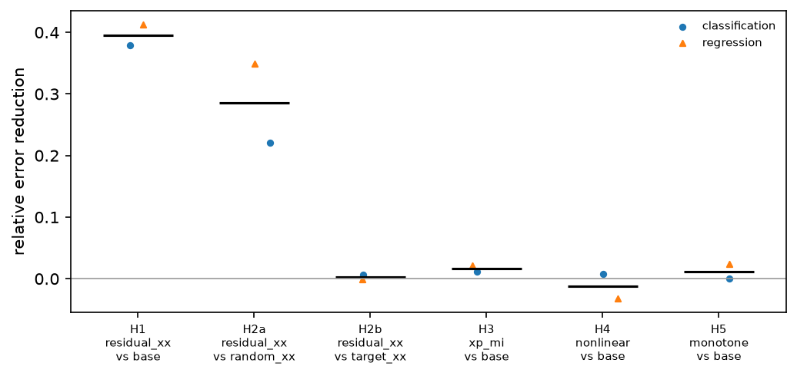
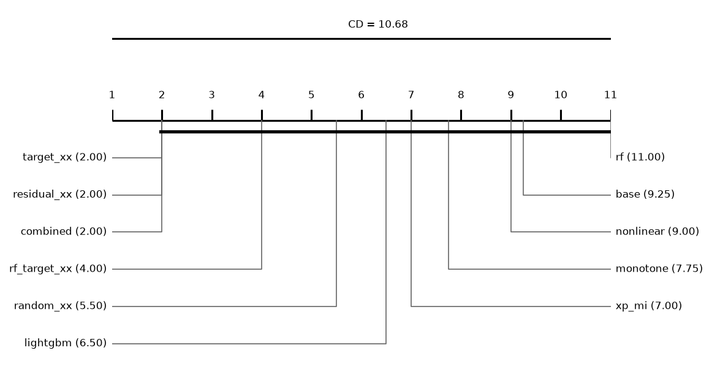
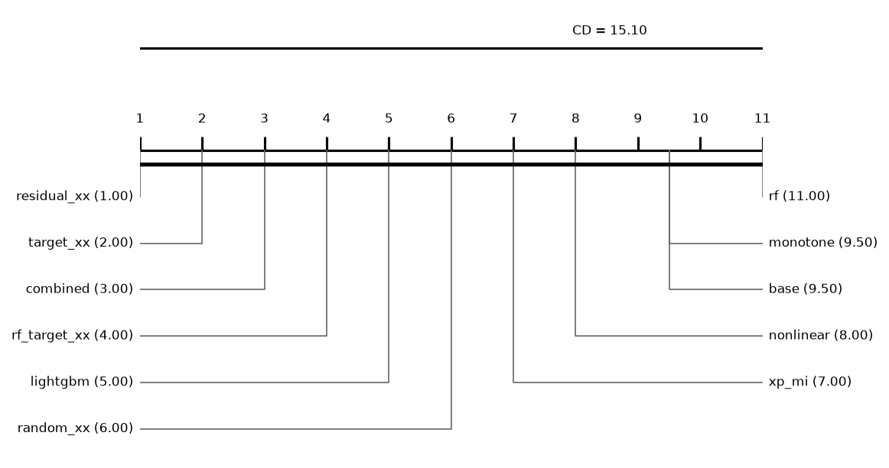
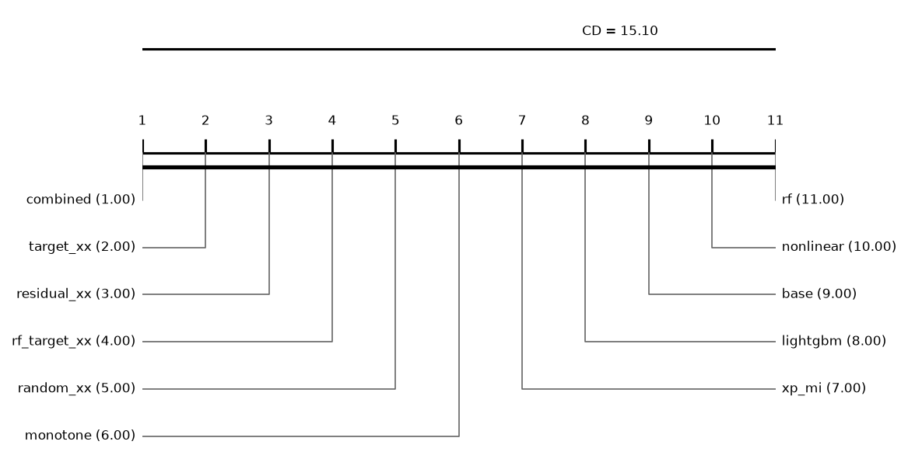

# Report: positive

330 runs on 2 datasets. Error = 1 - balanced accuracy (classification) or RMSE (regression); relative reduction = (e_ref - e) / max(e_ref, e) of errors averaged over a dataset's runs; positive favours the method.

**Bottom line: too few datasets to test** (2: no Wilcoxon p can fall below 0.05); read the per-dataset tables.

## Hypotheses (plan §5)
Two-sided Wilcoxon signed-rank over datasets, Holm over the six comparisons; supported iff adjusted p < 0.05 and median reduction > 0. **H2 supported: no** (needs H2a and H2b). *zeros*: datasets where both methods have the same mean error, e.g. when a variant that adds columns from layer 2 and base stop at layer 1 in every run; the test drops them. *hl_estimate*, *ci95_low/high*: Hodges-Lehmann estimate of the reduction and its exact 95% interval (descriptive, added after the main run).

| comparison | method | reference | datasets | median_reduction | wins | losses | zeros | p | hl_estimate | ci95_low | ci95_high | p_holm | supported |
|---|---|---|---|---|---|---|---|---|---|---|---|---|---|
| H1 | residual_xx | base | 2 | 0.3955 | 2 | 0 | 0 | 0.5 | 0.3955 | - | - | 1 | no |
| H2a | residual_xx | random_xx | 2 | 0.2852 | 2 | 0 | 0 | 0.5 | 0.2852 | - | - | 1 | no |
| H2b | residual_xx | target_xx | 2 | 0.0022 | 1 | 1 | 0 | 1 | 0.0022 | - | - | 1 | no |
| H3 | xp_mi | base | 2 | 0.0163 | 2 | 0 | 0 | 0.5 | 0.0163 | - | - | 1 | no |
| H4 | nonlinear | base | 2 | -0.0125 | 1 | 1 | 0 | 1 | -0.0125 | - | - | 1 | no |
| H5 | monotone | base | 2 | 0.0118 | 1 | 0 | 1 | 1 | 0.0118 | - | - | 1 | no |

## Hypotheses by task (exploratory)
Added after the main run at the instructor's suggestion: the six comparisons within each task, Holm over these 12. They decide no hypothesis (plan §5).

| task | comparison | method | reference | datasets | median_reduction | wins | losses | zeros | p | p_holm |
|---|---|---|---|---|---|---|---|---|---|---|
| classification | H1 | residual_xx | base | 1 | 0.3784 | 1 | 0 | 0 | 1 | 1 |
| classification | H2a | residual_xx | random_xx | 1 | 0.2211 | 1 | 0 | 0 | 1 | 1 |
| classification | H2b | residual_xx | target_xx | 1 | 0.0059 | 1 | 0 | 0 | 1 | 1 |
| classification | H3 | xp_mi | base | 1 | 0.011 | 1 | 0 | 0 | 1 | 1 |
| classification | H4 | nonlinear | base | 1 | 0.0072 | 1 | 0 | 0 | 1 | 1 |
| classification | H5 | monotone | base | 1 | 0 | 0 | 0 | 1 | 1 | 1 |
| regression | H1 | residual_xx | base | 1 | 0.4125 | 1 | 0 | 0 | 1 | 1 |
| regression | H2a | residual_xx | random_xx | 1 | 0.3494 | 1 | 0 | 0 | 1 | 1 |
| regression | H2b | residual_xx | target_xx | 1 | -0.0014 | 0 | 1 | 0 | 1 | 1 |
| regression | H3 | xp_mi | base | 1 | 0.0215 | 1 | 0 | 0 | 1 | 1 |
| regression | H4 | nonlinear | base | 1 | -0.0322 | 0 | 1 | 0 | 1 | 1 |
| regression | H5 | monotone | base | 1 | 0.0236 | 1 | 0 | 0 | 1 | 1 |

## The six comparisons on other metrics: classification (descriptive)
Error = 1 - metric where higher is better; two-sided Wilcoxon p without correction. Accuracy, ROC AUC, average precision and R² are computed from the saved float32 test predictions.

| metric | comparison | method | reference | datasets | median_reduction | wins | losses | zeros | p |
|---|---|---|---|---|---|---|---|---|---|
| accuracy | H1 | residual_xx | base | 1 | 0.3787 | 1 | 0 | 0 | 1 |
| accuracy | H2a | residual_xx | random_xx | 1 | 0.2212 | 1 | 0 | 0 | 1 |
| accuracy | H2b | residual_xx | target_xx | 1 | 0.0059 | 1 | 0 | 0 | 1 |
| accuracy | H3 | xp_mi | base | 1 | 0.011 | 1 | 0 | 0 | 1 |
| accuracy | H4 | nonlinear | base | 1 | 0.0074 | 1 | 0 | 0 | 1 |
| accuracy | H5 | monotone | base | 1 | 0 | 0 | 0 | 1 | 1 |
| roc_auc | H1 | residual_xx | base | 1 | 0.3182 | 1 | 0 | 0 | 1 |
| roc_auc | H2a | residual_xx | random_xx | 1 | 0.1629 | 1 | 0 | 0 | 1 |
| roc_auc | H2b | residual_xx | target_xx | 1 | 0.0071 | 1 | 0 | 0 | 1 |
| roc_auc | H3 | xp_mi | base | 1 | -0.0115 | 0 | 1 | 0 | 1 |
| roc_auc | H4 | nonlinear | base | 1 | -0.0026 | 0 | 1 | 0 | 1 |
| roc_auc | H5 | monotone | base | 1 | 0.0119 | 1 | 0 | 0 | 1 |
| average_precision | H1 | residual_xx | base | 1 | 0.2432 | 1 | 0 | 0 | 1 |
| average_precision | H2a | residual_xx | random_xx | 1 | 0.1209 | 1 | 0 | 0 | 1 |
| average_precision | H2b | residual_xx | target_xx | 1 | 0.0054 | 1 | 0 | 0 | 1 |
| average_precision | H3 | xp_mi | base | 1 | -0.0138 | 0 | 1 | 0 | 1 |
| average_precision | H4 | nonlinear | base | 1 | -0.0036 | 0 | 1 | 0 | 1 |
| average_precision | H5 | monotone | base | 1 | 0.0015 | 1 | 0 | 0 | 1 |
| log_loss | H1 | residual_xx | base | 1 | 0.1665 | 1 | 0 | 0 | 1 |
| log_loss | H2a | residual_xx | random_xx | 1 | 0.0821 | 1 | 0 | 0 | 1 |
| log_loss | H2b | residual_xx | target_xx | 1 | -0.0052 | 0 | 1 | 0 | 1 |
| log_loss | H3 | xp_mi | base | 1 | -0.0015 | 0 | 1 | 0 | 1 |
| log_loss | H4 | nonlinear | base | 1 | -0.000227 | 0 | 1 | 0 | 1 |
| log_loss | H5 | monotone | base | 1 | 0.0015 | 1 | 0 | 0 | 1 |
| macro_f1 | H1 | residual_xx | base | 1 | 0.3802 | 1 | 0 | 0 | 1 |
| macro_f1 | H2a | residual_xx | random_xx | 1 | 0.2223 | 1 | 0 | 0 | 1 |
| macro_f1 | H2b | residual_xx | target_xx | 1 | 0.0058 | 1 | 0 | 0 | 1 |
| macro_f1 | H3 | xp_mi | base | 1 | 0.0108 | 1 | 0 | 0 | 1 |
| macro_f1 | H4 | nonlinear | base | 1 | 0.0058 | 1 | 0 | 0 | 1 |
| macro_f1 | H5 | monotone | base | 1 | 0 | 0 | 0 | 1 | 1 |

## The six comparisons on other metrics: regression (descriptive)
Error = 1 - metric where higher is better; two-sided Wilcoxon p without correction. Accuracy, ROC AUC, average precision and R² are computed from the saved float32 test predictions.

| metric | comparison | method | reference | datasets | median_reduction | wins | losses | zeros | p |
|---|---|---|---|---|---|---|---|---|---|
| r2 | H1 | residual_xx | base | 1 | 0.6637 | 1 | 0 | 0 | 1 |
| r2 | H2a | residual_xx | random_xx | 1 | 0.5802 | 1 | 0 | 0 | 1 |
| r2 | H2b | residual_xx | target_xx | 1 | -0.0036 | 0 | 1 | 0 | 1 |
| r2 | H3 | xp_mi | base | 1 | 0.0501 | 1 | 0 | 0 | 1 |
| r2 | H4 | nonlinear | base | 1 | -0.0665 | 0 | 1 | 0 | 1 |
| r2 | H5 | monotone | base | 1 | 0.0482 | 1 | 0 | 0 | 1 |
| mae | H1 | residual_xx | base | 1 | 0.3769 | 1 | 0 | 0 | 1 |
| mae | H2a | residual_xx | random_xx | 1 | 0.313 | 1 | 0 | 0 | 1 |
| mae | H2b | residual_xx | target_xx | 1 | 0.0011 | 1 | 0 | 0 | 1 |
| mae | H3 | xp_mi | base | 1 | 0.0311 | 1 | 0 | 0 | 1 |
| mae | H4 | nonlinear | base | 1 | -0.0272 | 0 | 1 | 0 | 1 |
| mae | H5 | monotone | base | 1 | 0.02 | 1 | 0 | 0 | 1 |

## The six comparisons at a fixed depth (descriptive)
Every cascade cut at the same layer instead of its chosen one; only depths that every cascade run trained, so every run counts. Two-sided Wilcoxon p without correction.

| depth | comparison | method | reference | datasets | median_reduction | wins | losses | zeros | p |
|---|---|---|---|---|---|---|---|---|---|
| 1 | H1 | residual_xx | base | 2 | 0.4214 | 2 | 0 | 0 | 0.5 |
| 1 | H2a | residual_xx | random_xx | 2 | 0.3418 | 2 | 0 | 0 | 0.5 |
| 1 | H2b | residual_xx | target_xx | 2 | 0 | 0 | 0 | 2 | 1 |
| 1 | H3 | xp_mi | base | 2 | 0 | 0 | 0 | 2 | 1 |
| 1 | H4 | nonlinear | base | 2 | 0 | 0 | 0 | 2 | 1 |
| 1 | H5 | monotone | base | 2 | 0 | 0 | 0 | 2 | 1 |
| 2 | H1 | residual_xx | base | 2 | 0.4074 | 2 | 0 | 0 | 0.5 |
| 2 | H2a | residual_xx | random_xx | 2 | 0.3543 | 2 | 0 | 0 | 0.5 |
| 2 | H2b | residual_xx | target_xx | 2 | -0.000711 | 0 | 1 | 1 | 1 |
| 2 | H3 | xp_mi | base | 2 | 0.0015 | 2 | 0 | 0 | 0.5 |
| 2 | H4 | nonlinear | base | 2 | -0.0092 | 1 | 1 | 0 | 1 |
| 2 | H5 | monotone | base | 2 | 0.0078 | 1 | 1 | 0 | 1 |
| 3 | H1 | residual_xx | base | 2 | 0.4047 | 2 | 0 | 0 | 0.5 |
| 3 | H2a | residual_xx | random_xx | 2 | 0.3036 | 2 | 0 | 0 | 0.5 |
| 3 | H2b | residual_xx | target_xx | 2 | -0.0055 | 1 | 1 | 0 | 1 |
| 3 | H3 | xp_mi | base | 2 | 0.036 | 2 | 0 | 0 | 0.5 |
| 3 | H4 | nonlinear | base | 2 | -0.0195 | 0 | 2 | 0 | 0.5 |
| 3 | H5 | monotone | base | 2 | -0.0185 | 0 | 2 | 0 | 0.5 |

## Depth rule of the base cascade (descriptive)
*picked*: share of base runs whose chosen layer is this depth. *median_test_vs_oof*: median over runs of (OOF error - test error) / max of the two, with the OOF error from the depth score (1 - balanced accuracy, or √MSE); positive = the test error is lower than the OOF error the rule sees. *median_reduction* to *p*: base cut at this depth vs base at its chosen layer, over datasets; positive = the fixed depth has the lower error.

| depth | picked | picked_classification | picked_regression | median_test_vs_oof | median_reduction | wins | losses | zeros | p |
|---|---|---|---|---|---|---|---|---|---|
| 1 | 0.4 | 0.8 | 0 | 0.0048 | -0.1882 | 0 | 2 | 0 | 0.5 |
| 2 | 0.5333 | 0.1333 | 0.9333 | 0.168 | -0.0104 | 0 | 2 | 0 | 0.5 |
| 3 | 0.0667 | 0.0667 | 0.0667 | 0.2091 | -0.0208 | 1 | 1 | 0 | 1 |

## Other methods vs the base cascade (descriptive)
Two-sided Wilcoxon p without Holm's correction.

| comparison | method | reference | datasets | median_reduction | wins | losses | zeros | p |
|---|---|---|---|---|---|---|---|---|
| random_xx | random_xx | base | 2 | 0.1495 | 2 | 0 | 0 | 0.5 |
| target_xx | target_xx | base | 2 | 0.3941 | 2 | 0 | 0 | 0.5 |
| combined | combined | base | 2 | 0.399 | 2 | 0 | 0 | 0.5 |
| rf | rf | base | 2 | -0.2426 | 0 | 2 | 0 | 0.5 |
| rf_target_xx | rf_target_xx | base | 2 | 0.2797 | 2 | 0 | 0 | 0.5 |
| lightgbm | lightgbm | base | 2 | 0.1382 | 2 | 0 | 0 | 0.5 |

## Mean ranks
Friedman over 11 methods and 2 datasets: chi2 = 18.43, p = 0.0482; Nemenyi critical difference = 10.68 (descriptive).

| method | mean rank |
|---|---|
| target_xx | 2 |
| residual_xx | 2 |
| combined | 2 |
| rf_target_xx | 4 |
| random_xx | 5.5 |
| lightgbm | 6.5 |
| xp_mi | 7 |
| monotone | 7.75 |
| nonlinear | 9 |
| base | 9.25 |
| rf | 11 |

## Other methods vs the base cascade: classification (descriptive)
Two-sided Wilcoxon p without Holm's correction.

| comparison | method | reference | datasets | median_reduction | wins | losses | zeros | p |
|---|---|---|---|---|---|---|---|---|
| random_xx | random_xx | base | 1 | 0.202 | 1 | 0 | 0 | 1 |
| target_xx | target_xx | base | 1 | 0.3747 | 1 | 0 | 0 | 1 |
| combined | combined | base | 1 | 0.3711 | 1 | 0 | 0 | 1 |
| rf | rf | base | 1 | -0.0814 | 0 | 1 | 0 | 1 |
| rf_target_xx | rf_target_xx | base | 1 | 0.349 | 1 | 0 | 0 | 1 |
| lightgbm | lightgbm | base | 1 | 0.2643 | 1 | 0 | 0 | 1 |

## Mean ranks: classification
Friedman over 11 methods and 1 datasets: chi2 = nan, p = -; Nemenyi critical difference = 15.10 (descriptive).

| method | mean rank |
|---|---|
| residual_xx | 1 |
| target_xx | 2 |
| combined | 3 |
| rf_target_xx | 4 |
| lightgbm | 5 |
| random_xx | 6 |
| xp_mi | 7 |
| nonlinear | 8 |
| base | 9.5 |
| monotone | 9.5 |
| rf | 11 |

## Other methods vs the base cascade: regression (descriptive)
Two-sided Wilcoxon p without Holm's correction.

| comparison | method | reference | datasets | median_reduction | wins | losses | zeros | p |
|---|---|---|---|---|---|---|---|---|
| random_xx | random_xx | base | 1 | 0.097 | 1 | 0 | 0 | 1 |
| target_xx | target_xx | base | 1 | 0.4134 | 1 | 0 | 0 | 1 |
| combined | combined | base | 1 | 0.4269 | 1 | 0 | 0 | 1 |
| rf | rf | base | 1 | -0.4038 | 0 | 1 | 0 | 1 |
| rf_target_xx | rf_target_xx | base | 1 | 0.2105 | 1 | 0 | 0 | 1 |
| lightgbm | lightgbm | base | 1 | 0.0122 | 1 | 0 | 0 | 1 |

## Mean ranks: regression
Friedman over 11 methods and 1 datasets: chi2 = nan, p = -; Nemenyi critical difference = 15.10 (descriptive).

| method | mean rank |
|---|---|
| combined | 1 |
| target_xx | 2 |
| residual_xx | 3 |
| rf_target_xx | 4 |
| random_xx | 5 |
| monotone | 6 |
| xp_mi | 7 |
| lightgbm | 8 |
| base | 9 |
| nonlinear | 10 |
| rf | 11 |

## Common depth (descriptive)
Median relative reduction vs base at each depth reached by every cascade variant in a run; *runs* counts those runs, so deep rows rest on few.

| depth | random_xx | target_xx | residual_xx | xp_mi | nonlinear | monotone | combined | datasets | runs |
|---|---|---|---|---|---|---|---|---|---|
| 1 | 0.1209 | 0.4214 | 0.4214 | 0 | 0 | 0 | 0.4214 | 2 | 30 |
| 2 | 0.0803 | 0.4078 | 0.4074 | 0.0015 | -0.0092 | 0.0078 | 0.4091 | 2 | 30 |
| 3 | 0.1409 | 0.4078 | 0.4047 | 0.036 | -0.0195 | -0.0185 | 0.4167 | 2 | 30 |
| 4 | 0.0903 | 0.2506 | 0.2532 | -0.0821 | -0.1679 | -0.1965 | 0.2564 | 2 | 16 |

## XP products vs the predictions

Median over runs of the median max |corr| between chosen XP products and P: 0.165 (IQR 0.127-0.224).

## Per dataset: balanced_accuracy mean ± sd (classification)
| dataset | base | random_xx | target_xx | residual_xx | xp_mi | nonlinear | monotone | combined | rf | rf_target_xx | lightgbm |
|---|---|---|---|---|---|---|---|---|---|---|---|
| smoke_xor | 0.6982 ± 0.069 | 0.7592 ± 0.061 | 0.8113 ± 0.06 | 0.8124 ± 0.061 | 0.7015 ± 0.074 | 0.7004 ± 0.074 | 0.6982 ± 0.069 | 0.8102 ± 0.059 | 0.6714 ± 0.07 | 0.8035 ± 0.067 | 0.778 ± 0.05 |

## Per dataset: log_loss mean ± sd (classification)
| dataset | base | random_xx | target_xx | residual_xx | xp_mi | nonlinear | monotone | combined | rf | rf_target_xx | lightgbm |
|---|---|---|---|---|---|---|---|---|---|---|---|
| smoke_xor | 0.6167 ± 0.039 | 0.56 ± 0.053 | 0.5113 ± 0.082 | 0.514 ± 0.074 | 0.6177 ± 0.042 | 0.6169 ± 0.039 | 0.6158 ± 0.042 | 0.5141 ± 0.083 | 0.6167 ± 0.048 | 0.5155 ± 0.082 | 0.5522 ± 0.08 |

## Per dataset: macro_f1 mean ± sd (classification)
| dataset | base | random_xx | target_xx | residual_xx | xp_mi | nonlinear | monotone | combined | rf | rf_target_xx | lightgbm |
|---|---|---|---|---|---|---|---|---|---|---|---|
| smoke_xor | 0.6959 ± 0.069 | 0.7576 ± 0.061 | 0.8104 ± 0.06 | 0.8115 ± 0.061 | 0.6992 ± 0.075 | 0.6976 ± 0.075 | 0.6959 ± 0.069 | 0.8093 ± 0.059 | 0.6688 ± 0.069 | 0.8028 ± 0.067 | 0.7769 ± 0.05 |

## Per dataset: accuracy mean ± sd (classification)
| dataset | base | random_xx | target_xx | residual_xx | xp_mi | nonlinear | monotone | combined | rf | rf_target_xx | lightgbm |
|---|---|---|---|---|---|---|---|---|---|---|---|
| smoke_xor | 0.6978 ± 0.069 | 0.7589 ± 0.061 | 0.8111 ± 0.06 | 0.8122 ± 0.061 | 0.7011 ± 0.074 | 0.7 ± 0.073 | 0.6978 ± 0.069 | 0.81 ± 0.059 | 0.6711 ± 0.07 | 0.8033 ± 0.067 | 0.7778 ± 0.05 |

## Per dataset: roc_auc mean ± sd (classification)
| dataset | base | random_xx | target_xx | residual_xx | xp_mi | nonlinear | monotone | combined | rf | rf_target_xx | lightgbm |
|---|---|---|---|---|---|---|---|---|---|---|---|
| smoke_xor | 0.7425 ± 0.075 | 0.7902 ± 0.071 | 0.8232 ± 0.063 | 0.8244 ± 0.061 | 0.7395 ± 0.08 | 0.7418 ± 0.077 | 0.7455 ± 0.076 | 0.8219 ± 0.061 | 0.7291 ± 0.077 | 0.8231 ± 0.062 | 0.8066 ± 0.06 |

## Per dataset: average_precision mean ± sd (classification)
| dataset | base | random_xx | target_xx | residual_xx | xp_mi | nonlinear | monotone | combined | rf | rf_target_xx | lightgbm |
|---|---|---|---|---|---|---|---|---|---|---|---|
| smoke_xor | 0.7378 ± 0.076 | 0.7743 ± 0.066 | 0.8005 ± 0.072 | 0.8016 ± 0.069 | 0.7341 ± 0.079 | 0.7368 ± 0.077 | 0.7382 ± 0.079 | 0.8002 ± 0.068 | 0.7261 ± 0.076 | 0.8 ± 0.069 | 0.7858 ± 0.067 |

## Per dataset: cpu_seconds mean ± sd (classification)
| dataset | base | random_xx | target_xx | residual_xx | xp_mi | nonlinear | monotone | combined | rf | rf_target_xx | lightgbm |
|---|---|---|---|---|---|---|---|---|---|---|---|
| smoke_xor | 1.711 ± 0.3 | 2.407 ± 1 | 2.086 ± 0.66 | 1.872 ± 0.4 | 2.151 ± 0.72 | 1.828 ± 0.23 | 1.84 ± 0.23 | 1.961 ± 0.36 | 0.2298 ± 0.0033 | 0.2375 ± 0.0037 | 0.4831 ± 0.095 |

## Per dataset: rmse mean ± sd (regression)
| dataset | base | random_xx | target_xx | residual_xx | xp_mi | nonlinear | monotone | combined | rf | rf_target_xx | lightgbm |
|---|---|---|---|---|---|---|---|---|---|---|---|
| smoke_pair | 1.667 ± 0.29 | 1.505 ± 0.34 | 0.9778 ± 0.15 | 0.9792 ± 0.15 | 1.631 ± 0.28 | 1.722 ± 0.29 | 1.628 ± 0.28 | 0.9553 ± 0.16 | 2.796 ± 0.35 | 1.316 ± 0.23 | 1.646 ± 0.3 |

## Per dataset: mae mean ± sd (regression)
| dataset | base | random_xx | target_xx | residual_xx | xp_mi | nonlinear | monotone | combined | rf | rf_target_xx | lightgbm |
|---|---|---|---|---|---|---|---|---|---|---|---|
| smoke_pair | 1.12 ± 0.16 | 1.016 ± 0.2 | 0.6987 ± 0.083 | 0.6979 ± 0.082 | 1.085 ± 0.15 | 1.151 ± 0.16 | 1.098 ± 0.15 | 0.6907 ± 0.085 | 1.954 ± 0.24 | 0.8947 ± 0.12 | 1.147 ± 0.15 |

## Per dataset: r2 mean ± sd (regression)
| dataset | base | random_xx | target_xx | residual_xx | xp_mi | nonlinear | monotone | combined | rf | rf_target_xx | lightgbm |
|---|---|---|---|---|---|---|---|---|---|---|---|
| smoke_pair | 0.6929 ± 0.13 | 0.754 ± 0.084 | 0.8971 ± 0.023 | 0.8967 ± 0.023 | 0.7083 ± 0.1 | 0.6711 ± 0.14 | 0.7077 ± 0.12 | 0.9018 ± 0.023 | 0.1508 ± 0.22 | 0.8147 ± 0.043 | 0.6984 ± 0.13 |

## Per dataset: cpu_seconds mean ± sd (regression)
| dataset | base | random_xx | target_xx | residual_xx | xp_mi | nonlinear | monotone | combined | rf | rf_target_xx | lightgbm |
|---|---|---|---|---|---|---|---|---|---|---|---|
| smoke_pair | 1.996 ± 0.13 | 2.198 ± 0.31 | 1.985 ± 0.014 | 1.984 ± 0.0092 | 2.227 ± 0.24 | 2.011 ± 0.011 | 2.003 ± 0.012 | 2.127 ± 0.024 | 0.1852 ± 0.0025 | 0.1922 ± 0.0074 | 0.814 ± 0.11 |
